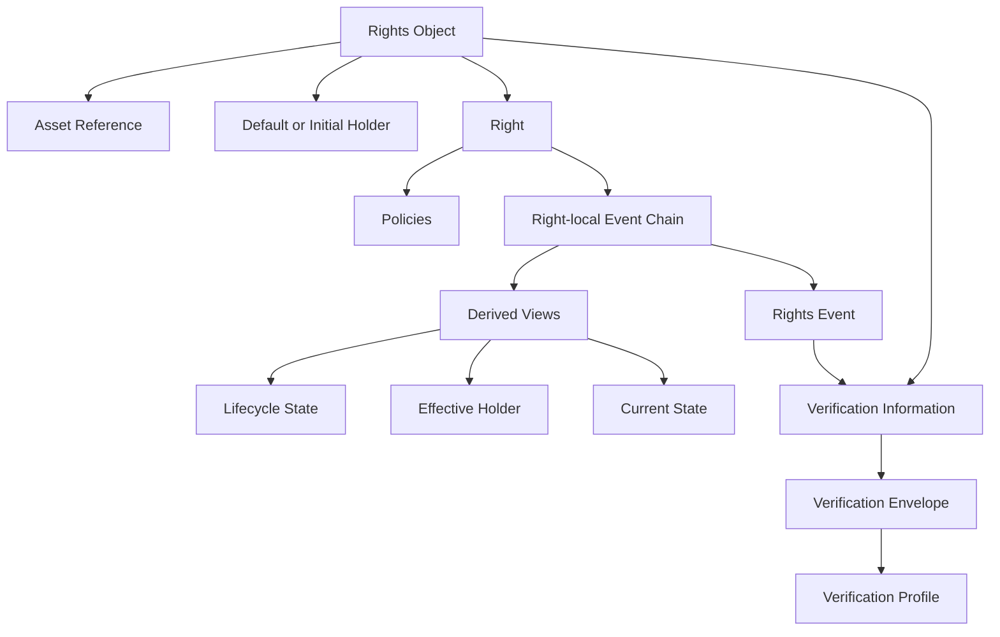
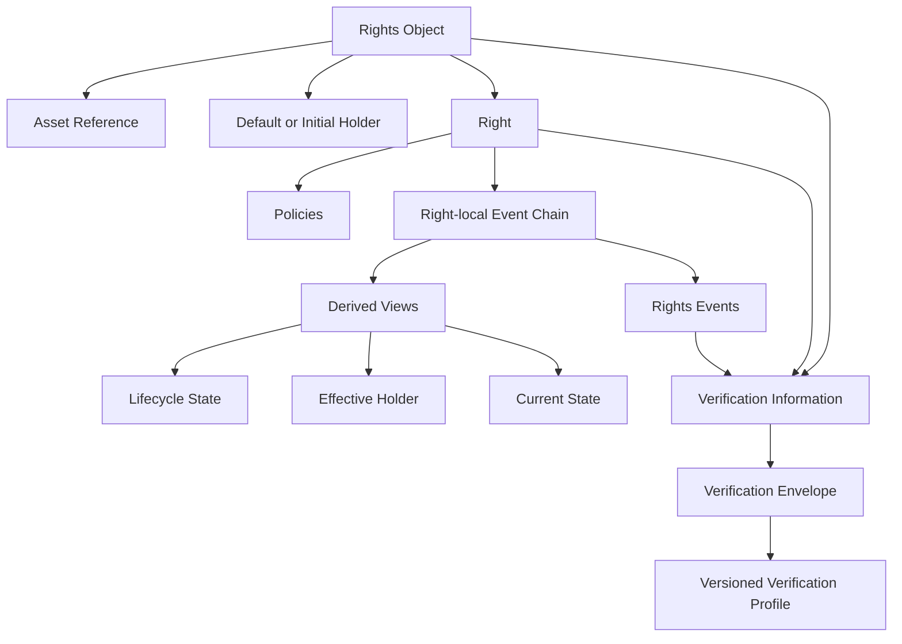
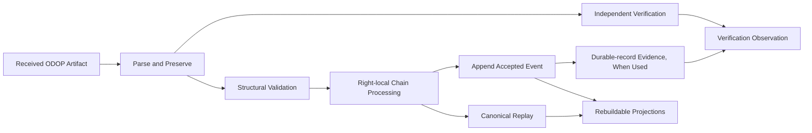
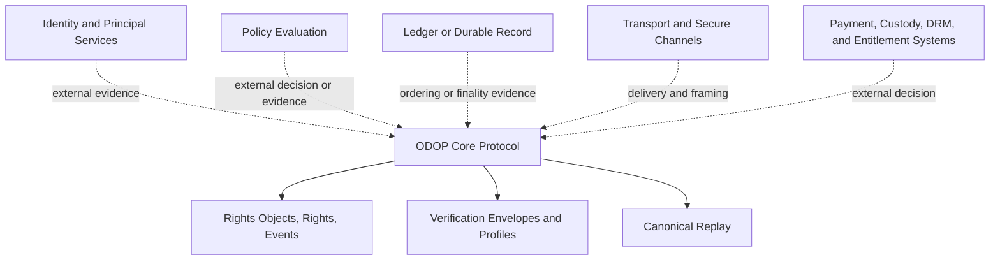

# ODOP Protocol Specification

**Working draft — Chapters 1–34 and Appendices A–H accepted; publication preparation pending**

This document was developed and reviewed one chapter at a time. Its chapter
order is the accepted published order. All chapters and appendices in this
working draft are accepted; publication remains subject to the future
maintenance and governance process.

## Table of Contents

1. Document Status and Publication Information
2. Abstract
3. Scope
4. Conformance and Normative Language
5. Design Principles
6. Terminology and Notation
7. Core Concepts
8. Protocol Overview
9. Protocol Roles and External Boundaries
10. Versioning and Compatibility
11. Identifiers and References
12. Core Information Model
13. Rights Object Model
14. Right Model
15. Policy Attachments
16. Rights Events
17. Lifecycle and Replay Model
18. Holder and Transfer Representation
19. Verification Information and Evidence
20. Verification Envelope
21. Verification Profiles
22. Protocol Processing Model
23. Validation and Error Reporting
24. Serialization and Interchange Formats
25. Extensions and Unknown Data Preservation
26. Registries
27. Conformance Levels and Declarations
28. Interoperability Requirements
29. Security Considerations
30. Privacy Considerations
31. Operational and Preservation Considerations
32. Implementation Considerations
33. IANA-Style Registry Considerations
34. Change Control and Maintenance

Appendix A. Protocol Object Relationship Diagrams

Appendix B. Processing and Replay Examples

Appendix C. Interchange Examples

Appendix D. Conformance Declaration Template

Appendix E. Registry Templates

Appendix F. Implementation Architecture Relationship

Appendix G. Open Issues and Deferred Work

Appendix H. Revision History

## 1. Document Status and Publication Information

This chapter identifies the status, authority, and publication relationship of
the ODOP Protocol Specification.

### 1.1 Document status

This document is a working draft of the ODOP Protocol Specification. It is
being developed through chapter-by-chapter review and has not yet been published
as an ODOP Version 1.0 standard.

Accepted chapters record the project’s approved draft content. Pending chapters,
appendices, registries, profiles, schemas, fixtures, and governance material do
not create a published protocol requirement until they are completed, approved,
versioned, and released through the future maintenance process.

### 1.2 Normative source

When published, the ODOP Protocol Specification is the primary normative source
for ODOP semantics. It defines the meaning and processing requirements of ODOP
artifacts, including Rights Objects, Rights, Rights Events, Verification
Envelopes, Verification Profiles, and related protocol material.

The Reference Implementation Architecture is non-normative implementation
guidance. It supports implementation consistency but does not amend, replace,
or reinterpret the Protocol Specification. If a future published discrepancy
arises, the published Protocol Specification governs protocol semantics.

### 1.3 Publication identity

A published release of this specification will identify, at minimum:

- the document title;
- the ODOP protocol version;
- publication status;
- publication date;
- a stable publication identifier or location;
- applicable registry, profile, representation, and conformance references;
  and
- its relationship to prior releases, errata, or superseded material.

This working draft does not yet assign a Version 1.0 publication identifier,
release date, or publication authority.

### 1.4 Status of supporting material

This specification anticipates supporting published material, including
Verification Profiles, interchange representation specifications, registries,
extension definitions, conformance fixtures, and maintenance records. Such
material is authoritative only when it is versioned and published through the
applicable process.

Local implementation documentation, product behavior, architecture discussion,
issue records, roadmap items, and unpublished drafts do not create ODOP
protocol semantics.

### 1.5 Draft review and change control

The working draft is reviewed one chapter or appendix at a time. Acceptance of a
draft chapter records project agreement on that chapter’s content for this
working draft; it does not itself create a public standard, registry entry, or
conformance claim.

Future published maintenance and revision procedures are governed by Chapter
34 and the future protocol-governance framework.

### 1.6 Revision history

The publication history for this working draft and future releases is recorded
in Appendix H. In this working draft, that appendix records accepted drafting
milestones and does not yet constitute a formal public-release record.

## 2. Abstract

ODOP is an open protocol for expressing, transferring, verifying, and
preserving digital ownership rights. It represents rights through Rights Objects
and independently addressable Rights, with immutable Right-local event chains as
the authoritative basis for replaying lifecycle state and effective-holder
information.

ODOP is vendor-neutral, ledger-neutral, and transport-neutral. It does not
define tokens, balances, wallets, accounts, smart-contract execution, asset
custody, policy evaluation, payment, or legal entitlement. Those functions can
be provided by external systems without changing core ODOP semantics.

The protocol supports independent verification through Verification Envelopes
and versioned Verification Profiles, enabling algorithm agility and long-term
preservation. It preserves unknown optional extensions, separates authoritative
event history from rebuildable views, and supports interoperable exchange across
different storage, ledger, cryptographic, network, identity, and policy
deployments.

## 3. Scope

This specification defines the ODOP protocol model for expressing,
transferring, verifying, and preserving digital ownership rights as interoperable
digital artifacts.

### 3.1 In scope

This specification covers:

- the conceptual and core information model for Rights Objects, Rights, policy
  attachments, Rights Events, and derived Right-level views;
- canonical Right references and Right-local event-chain relationships;
- lifecycle replay and holder-related protocol semantics;
- verification information, Verification Envelopes, and the Verification Profile
  framework;
- protocol processing, validation, error reporting, extensions, registries,
  conformance declarations, and interoperability requirements;
- protocol-level security, privacy, preservation, and maintenance
  considerations; and
- the framework for future representation specifications, profiles, registries,
  conformance material, and governance processes.

### 3.2 Out of scope

This specification does not define:

- ownership law, legal title, jurisdictional rights, or legal enforceability;
- principal identity, identity authentication, principal equality, or issuer
  governance;
- policy language, policy evaluation, policy precedence, or policy enforcement;
- payment, currency, balances, tokens, wallets, accounts, smart-contract
  execution, or commercial entitlement;
- asset delivery, asset custody, DRM, access control, or content hosting;
- a mandatory ledger, blockchain, consensus mechanism, database, storage
  system, network transport, API, or deployment topology;
- a mandatory cryptographic algorithm, key-management system, certificate
  policy, trust-anchor model, or secure-channel mechanism;
- a default interchange representation, schema, media type, or transport
  binding; or
- a registry operator, governance organization, certification authority, or
  legal compliance regime.

### 3.3 Relationship to external systems

An ODOP deployment can integrate with external identity, policy, payment,
custody, storage, ledger, transport, and security services. The outputs of
those systems remain external evidence or external decisions unless a published
ODOP definition expressly specifies their representation and processing.

Such integrations must not change canonical Right identity, event-chain replay
order, lifecycle semantics, effective-holder derivation, or the meaning of
standard protocol information.

### 3.4 Supporting publications

Verification Profiles, representation specifications, extension definitions,
registry entries, conformance fixtures, and maintenance records can supplement
this specification when they are versioned and published through the applicable
process. They operate within the boundaries established here and do not expand
core ODOP semantics by implication.

### 3.5 Scope limitations

This specification does not guarantee that an ODOP artifact is legally valid,
that a holder is authorized, that an asset is available, that a policy is
satisfied, that a signature is trusted, or that a deployment is secure. It
defines the protocol information and processing framework that implementations
use to express and assess available evidence within their declared scope.

## 4. Conformance and Normative Language

This chapter defines how normative requirements and conformance claims are
expressed in this specification.

### 4.1 Normative language

The key words **MUST**, **MUST NOT**, **REQUIRED**, **SHALL**, **SHALL NOT**,
**SHOULD**, **SHOULD NOT**, **RECOMMENDED**, **NOT RECOMMENDED**, **MAY**, and
**OPTIONAL** in this document are to be interpreted as described in BCP 14 when,
and only when, they appear in all capitals.

Lowercase uses of these words retain their ordinary English meaning.

### 4.2 Normative content

A statement is normative when it expresses a requirement, prohibition,
permission, or condition necessary to preserve ODOP protocol semantics,
interoperability, validation, verification, or conformance.

Normative requirements can appear in prose, tables, or formally published
profiles, representation specifications, registry entries, and conformance
material that this specification incorporates by reference. A table entry is
normative only when its context states that it defines a requirement.

### 4.3 Informative content

Examples, diagrams, explanatory notes, rationale, implementation
considerations, security and privacy guidance, and descriptive summaries are
informative unless they contain an explicit normative statement.

Chapter 32 is explicitly non-normative. The Reference Implementation
Architecture and other implementation documentation are non-normative unless a
future published Protocol Specification expressly incorporates a specific
requirement.

### 4.4 Conformance claims

An implementation makes an ODOP conformance claim only within the declared
scope described in Chapter 27. A claim identifies the protocol version,
representations, Verification Profiles, extensions, registry material, and
capabilities to which it applies.

A conforming implementation must satisfy the normative requirements applicable
to its declared scope. It must not claim support for a requirement, profile,
representation, extension, or conformance level that it cannot process in
accordance with the relevant published material.

### 4.5 Requirement scope and limitations

Normative requirements apply to the role, artifact, processor, verifier,
registry function, or other subject named by the requirement. They do not
create an unstated role-based authorization model, legal obligation, or
deployment mandate.

A requirement that depends on unavailable or unsupported external information
is handled through the validation and verification frameworks. An implementation
must report the applicable limitation rather than silently substitute a local
interpretation.

### 4.6 References to future material

Where this specification refers to a future profile, representation,
registry, fixture suite, governance framework, or protocol disposition, that
reference does not create an unstated requirement before the referenced material
is published. Open protocol decisions remain non-normative until resolved
through the maintenance process.

## 5. Design Principles

This chapter states the design principles that guide interpretation and future
maintenance of ODOP. It is informative and does not add requirements beyond the
normative chapters.

### 5.1 Protocol neutrality

ODOP defines interoperable protocol artifacts and processing semantics without
requiring a particular vendor, ledger, blockchain, database, network transport,
cryptographic provider, identity system, policy engine, or commercial platform.

Deployment choices can provide additional capabilities, but they do not change
the core meaning of a Rights Object, Right, Rights Event, Verification Envelope,
or derived protocol view.

### 5.2 Right-level independence

A Right is the smallest independently addressable unit of rights. Lifecycle
state, effective holder, policies, and event history are Right-scoped. A
relationship at Rights Object scope does not implicitly replace or propagate
Right-level semantics.

This principle prevents an aggregate grouping from becoming an unexpressed
source of state, holder, policy, or event effects.

### 5.3 Immutable evidence and derived views

Rights Events are append-only protocol facts. Corrections and later changes are
represented through additional events rather than mutation or deletion of
historical events.

Current state, lifecycle status, effective holder, caches, projections,
snapshots, indexes, and analytics are derived views. They improve usability and
performance but do not replace authoritative event history.

### 5.4 Deterministic, independent replay

Canonical Right-local replay is determined by the predecessor chain and
sequence continuity, not by timestamp, transport arrival, storage insertion, or
ledger order. Independent implementations should be able to reproduce the same
derived result from the same complete, valid event chain and applicable
published rules.

### 5.5 Evidence without implicit decisions

Verification information, evidence, and observations are kept separate from
the artifacts they evaluate. Verification reports what available evidence
supports, including indeterminate conditions; it does not silently become a
policy, legal, authorization, admission, or commercial decision.

Likewise, external decisions are not represented as core ODOP facts without an
explicit published protocol definition.

### 5.6 Preservation and forward compatibility

ODOP preserves received protocol information and unknown optional extensions.
An implementation that does not understand an extension or a historical profile
should retain the applicable artifact and report its limitation rather than
silently discard, rewrite, or reinterpret it.

Long-term interpretability depends on preserving authoritative event history,
received representations where required, profiles, registries, and verification
evidence.

### 5.7 Algorithm agility and historical integrity

Verification Profiles allow cryptographic and verification procedures to evolve
without changing the core meaning of protocol artifacts. A newer algorithm,
profile, or implementation preference does not authorize rewriting historical
protected information or replacing its referenced verification context.

### 5.8 Explicit evolution

New protocol semantics, profiles, representations, extensions, registries, and
conformance requirements are introduced through explicit, versioned publication.
Unresolved questions, local conventions, and implementation choices do not
become interoperable protocol rules by implication.

### 5.9 Clear external boundaries

ODOP avoids defining legal title, identity, policy evaluation, payment, asset
custody, DRM, access control, and commercial entitlement unless these are
separately standardized. This preserves a narrow, durable protocol core that
can operate alongside diverse external systems.

### 5.10 Open interoperability

The protocol is designed for independent implementation and exchange across
different deployments. Interoperability is based on published protocol versions,
representations, profiles, registries, and extension definitions—not on common
vendor infrastructure or shared operational assumptions.

## 6. Terminology and Notation

This chapter defines the terminology and notation used in this specification.
The definitions summarize the accepted protocol model; detailed requirements are
located in the chapters referenced by each term.

### 6.1 Core artifacts

| Term | Meaning |
| --- | --- |
| ODOP artifact | A protocol-defined item that can be exchanged, preserved, or verified in an ODOP system. |
| Rights Object | The aggregate artifact that associates an asset reference with a collection of Rights. |
| Right | The smallest independently addressable unit of rights within a Rights Object. |
| Asset reference | Information that identifies or locates the asset context of a Rights Object; it is not the asset content itself. |
| Rights Event | An immutable, append-only protocol fact concerning one Right. |
| Event chain | The ordered Right-local chain of Rights Events connected by predecessor references and sequence continuity. |
| Genesis event | The event in a Right-local chain that has no predecessor reference. |

### 6.2 Identity and references

| Term | Meaning |
| --- | --- |
| objectId | The identifier of a Rights Object. |
| rightId | The identifier of a Right within its owning Rights Object. |
| Canonical Right reference | The ordered pair (objectId, rightId) that identifies a Right at protocol scope. |
| Event identity | The identity by which a Rights Event can be distinguished and referenced by a successor event. |
| Predecessor reference | A reference from a non-genesis Rights Event to the preceding event in the same Right-local chain. |
| Principal reference | Information used to refer to a Holder or another external principal; its syntax and resolution are not defined by this specification. |

### 6.3 Derived information

| Term | Meaning |
| --- | --- |
| Lifecycle state | The state of a Right derived by replaying its event chain. |
| Current state | A derived view of a Right at a particular event-chain prefix. |
| Status | A represented derived lifecycle value that can be checked against canonical replay; it is not an independent authoritative fact. |
| Holder | The principal associated with a Right for holder-related protocol purposes. |
| Default or initial holder | Aggregate Rights Object information that supplies starting holder context for a Right with no applicable Right-specific holder history. |
| Effective holder | The holder derived for an individual Right from its applicable starting context and event history. |
| Projection | A rebuildable view, index, cache, snapshot, search result, or other derived representation of authoritative protocol information. |

### 6.4 Policy and verification terms

| Term | Meaning |
| --- | --- |
| Policy | Protocol information attached to an individual Right; ODOP does not define its evaluation or legal effect. |
| Policy attachment | The association of a Policy with a Right through that Right's policies collection. |
| Verification information | Submitted or referenced protocol material that supports verification of an ODOP artifact. |
| Verification evidence | Information used in a verification operation, whether supplied or independently collected. |
| Verification observation | A scoped record of checks, evidence, limitations, and a verification result. |
| Verification result | A result category of valid, invalid, or indeterminate for the stated verification scope. |
| Verification Envelope | The canonical protocol artifact that associates verification information with exactly one versioned Verification Profile. |
| Verification Profile | A versioned, registry-managed definition of profile-dependent verification procedure and evidence processing. |

### 6.5 Interchange, extension, and registry terms

| Term | Meaning |
| --- | --- |
| Interchange representation | A published format-specific representation of ODOP artifacts. |
| Transport envelope | Routing, delivery, authentication, confidentiality, or framing information outside the ODOP payload. |
| Extension | Information outside the standard fields and semantics defined by this specification. |
| Unknown extension | An extension a processor preserves but does not interpret under a supported published definition. |
| Registry | A versioned, published record of protocol-controlled values or definitions. |
| Registry entry | A published, identifiable item in an ODOP registry. |

### 6.6 Processing terms

| Term | Meaning |
| --- | --- |
| Processor | A system that receives, parses, preserves, validates, replays, or exports ODOP artifacts. |
| Verifier | A system that performs independent verification of ODOP artifacts and available evidence. |
| Durable record | A storage, ledger, archive, or other mechanism that provides preservation, ordering, inclusion, replication, or finality evidence. |
| Deployment | A concrete implementation context for ODOP, including its chosen storage, network, cryptographic, identity, policy, and operational systems. |
| Authoritative information | Protocol information that is the source of truth for its defined meaning, including immutable event history. |
| Derived view | Information produced from authoritative protocol information and not itself a replacement source of truth. |

### 6.7 Notation

This specification uses (objectId, rightId) to denote a canonical Right
reference. The notation identifies the ordered pair, not a particular string
encoding, tuple syntax, or serialization format.

Arrows and diagrams illustrate relationships or processing flow unless their
surrounding text explicitly states a normative requirement. Lowercase technical
terms retain their ordinary meaning unless defined in this chapter or a
referenced normative section.

## 7. Core Concepts

This chapter introduces the concepts that organize ODOP. It establishes a
shared conceptual vocabulary; the detailed data model, processing, validation,
serialization, and conformance requirements for these concepts are specified in
later chapters.

### 7.1 Protocol artifacts

An **ODOP artifact** is a protocol-defined item that can be exchanged,
preserved, or verified in an ODOP system. The primary protocol artifacts are a
Rights Object, a Right, a Rights Event, policy attachments, and verification
information. This specification defines their relationships without requiring a
particular ledger, database, transport, identity system, or policy engine.

### 7.2 Rights Object

A **Rights Object** is the aggregate protocol artifact used to express rights
associated with an asset reference. It provides the context that owns a
collection of individual Rights and may contain aggregate metadata and
verification information.

A Rights Object is not the digital content itself. ODOP retains a reference to
the asset; it does not require the asset content to be embedded in a Rights
Object or an event record.

### 7.3 Right

A **Right** is the smallest independently addressable unit of rights within a
Rights Object. A Right has its own identity within its owning Rights Object and
is the unit to which policies, events, lifecycle state, and effective-holder
information relate.

A Right is identified in protocol processing by its canonical Right reference:
the pair consisting of the owning Rights Object identifier and the Right
identifier. The detailed identifier and reference representation is specified
elsewhere in this document.

### 7.4 Holder

A **Holder** is the principal associated with a Right for holder-related
protocol purposes. A Rights Object may provide a default or initial holder.
When a Right has no Right-specific holder history, it uses that default or
initial holder.

The **effective holder** is the holder derived for an individual Right from the
applicable protocol information and its event history. A holder-related event
affects only its referenced Right; it does not implicitly change the holders of
other Rights in the same Rights Object.

The syntax, resolution, authentication, and legal meaning of principal
references are not defined by this chapter.

### 7.5 Rights Event

A **Rights Event** is an immutable, append-only protocol fact concerning one
Right. It identifies the Rights Object and Right to which it applies. Rights
Events form a Right-local event chain through predecessor references and
Right-local sequence information.

An event chain is the authoritative record used to derive lifecycle state and
other event-derived information for its referenced Right. An event does not
mutate an earlier event or overwrite the authoritative history.

### 7.6 Lifecycle state and current state

A **lifecycle state** is the state associated with a Right as derived by
replaying its event chain according to the lifecycle model.

**Current state** is a derived view of a Right at a particular event-chain
prefix. It is not an independent authoritative fact. A serialized status value,
when present, represents the deterministic result of replay and can be checked
against the event chain; it does not replace that chain as the source of truth.

### 7.7 Policy attachment

A **Policy** is protocol information associated with a Right. A Right may have
a collection of policy attachments. The collection supports deterministic
representation and verification; its order does not itself express policy
priority, execution order, or a business decision.

ODOP expresses policy attachments but does not define policy evaluation,
conflict resolution, legal interpretation, payment, DRM, or commercial
entitlement decisions. Such functions are external to the protocol core.

### 7.8 Verification information and evidence

**Verification information** is protocol-supplied material that supports
independent checks of an ODOP artifact. **Verification evidence** is material
used or collected in performing such checks, including evidence related to
integrity, signatures, issuers, certificates, timestamps, event continuity, and
durable-record inclusion where available.

A **verification result** is an observation produced from available evidence.
It does not replace the submitted ODOP artifact, its event chain, or external
trust material.

### 7.9 Verification Envelope and Verification Profile

A **Verification Envelope** is the protocol artifact that binds verification
information to one referenced **Verification Profile**.

A Verification Profile is a versioned, registry-managed description of the
verification details needed to process an envelope, such as canonicalization,
signature input, algorithms, parameter sets, encodings, key identifiers,
certificate binding, and supported evidence types. Profiles enable algorithm
agility without changing the core meaning of an ODOP artifact.

### 7.10 Extension

An **extension** is protocol data outside the standard fields defined by this
specification. Extensions allow an artifact to carry additional information
without changing the meaning of the standard fields.

An implementation can preserve an extension even when it does not interpret
it. The extension framework, including naming, representation, and interchange
requirements, is specified elsewhere in this document.

### 7.11 Registry

A **registry** is a versioned, published record of values and profiles used by
the protocol. Registries support shared interpretation and long-term
interoperability without embedding changing administrative data in application
code.

### 7.12 Deployment and external systems

A **deployment** is a concrete implementation context for ODOP. It may use
particular storage, ordering, ledger, cryptographic, transport, identity, and
policy-evaluation systems. These are implementation choices and do not change
the meaning of ODOP protocol artifacts.

ODOP does not define tokens, balances, wallets, smart-contract execution,
asset custody, or an account model as protocol concepts.

## 8. Protocol Overview

This chapter provides a high-level overview of ODOP and the relationships among
its protocol artifacts. It is descriptive: detailed normative requirements are
defined in the referenced chapters.

### 8.1 Overview

ODOP is a protocol for expressing, transferring, verifying, and preserving
digital ownership rights through interoperable protocol artifacts. It separates
the expression of rights from the deployment systems that store, transport,
verify, or evaluate those artifacts.

The protocol is centered on a Rights Object and its independently addressable
Rights. A Right has a Right-local, append-only event chain. Canonical replay of
that chain derives lifecycle state and effective-holder information. Verification
information and a profile-bound Verification Envelope support independent
assessment without changing the artifacts being assessed.

### 8.2 Conceptual flow

The following flow summarizes the relationship among the principal artifacts and
processes:

    Rights Object
      -> contains independently addressable Rights
      -> each Right has policies and a Right-local event chain
      -> replay of the event chain derives Right-level views
      -> verification information is bound through a Verification Envelope
      -> the envelope references one versioned Verification Profile

    Received artifact
      -> parse and preserve
      -> validate and verify
      -> replay the authoritative Right-local event chain
      -> append accepted events immutably
      -> rebuild derived views and interoperability outputs

The flow is independent of any particular API, ledger, database, network,
identity service, policy engine, or cryptographic provider.

### 8.3 Authoritative and derived information

The authoritative history of a Right consists of its immutable Rights Events
and their canonical chain relationships. Lifecycle state, current state,
effective holder, indexes, snapshots, caches, and search results are derived
from authoritative information.

A derived view can be useful for query and operation, but it does not replace
the event chain as the source of protocol truth. When a derived value and the
available event chain disagree, the difference is evidence to be reported, not
a condition to be silently repaired.

### 8.4 Verification model

ODOP distinguishes submitted verification information, evidence, and
verification observations. A Verification Envelope identifies the exact,
versioned Verification Profile used for profile-dependent processing. A
verification result reports valid, invalid, or indeterminate evidence within a
stated scope; it does not make a policy, legal, authorization, or commercial
decision.

Profiles permit different cryptographic and verification procedures to coexist
without changing the core meaning of a Rights Object, Right, or Rights Event.

### 8.5 Interoperability model

Independent implementations interoperate by using the same published protocol
version, interchange representation, Verification Profiles, registry material,
and extension definitions within their declared capability scope. ODOP supports
exchange across different storage, ledger, network, identity, and policy
deployments because those choices do not define core protocol semantics.

Unknown optional extensions are preserved without being given locally invented
meaning. A processor that cannot complete a required check reports the
applicable limitation rather than silently substituting a local interpretation.

### 8.6 External boundaries

ODOP does not define tokens, balances, wallets, accounts, smart-contract
execution, asset custody, payment, DRM, policy evaluation, principal identity,
legal title, or commercial entitlement. Deployments can integrate with systems
that provide such functions, but their decisions remain external to the core
protocol unless separately standardized.

### 8.7 Relationship to later chapters

Chapters 9 through 11 define protocol roles and boundaries, versioning, and
identifiers. Chapters 12 through 28 define the information model, event and
verification processing, representations, extensions, conformance, and
interoperability framework. Chapters 29 through 34 address security, privacy,
preservation, implementation guidance, registries, and maintenance.

This chapter does not add requirements beyond those chapters.

## 9. Protocol Roles and External Boundaries

This chapter describes the functional roles that can participate in an ODOP
deployment and the boundaries between protocol processing and external systems.
Roles describe functions, not legal identities, permissions, trustworthiness, or
organizational structure. One entity can perform multiple roles, and a role can
be distributed across multiple entities.

### 9.1 Role model

ODOP does not require a central operator, a particular ledger, a single
implementation, or a fixed network topology. It defines interoperable artifacts
and processing responsibilities that can be performed by independent systems.

The protocol does not infer authority from role assignment. A system that
submits, stores, verifies, transports, or indexes an artifact is not thereby
the holder, issuer, rights owner, policy authority, legal custodian, or trusted
identity provider.

### 9.2 Protocol artifact producer

A protocol artifact producer creates or exports a Rights Object, Right, Policy,
Rights Event, Verification Envelope, or another ODOP artifact in a supported
representation. The producer is responsible for preserving the applicable
protocol information and referenced profile or registry information in the
artifact it produces.

Producing an artifact does not establish that the producer was authorized to do
so or that the artifact is legally valid. Authorization and legal assessment are
outside this role model unless separately standardized.

### 9.3 Protocol processor

A protocol processor receives, parses, preserves, structurally validates,
replays, or exports ODOP artifacts. It applies the processing and validation
model of Chapters 22 and 23 within its declared capabilities.

A processor must distinguish authoritative event history from its local derived
views. It does not gain authority to rewrite historical protocol facts merely
because it stores or processes them.

### 9.4 Verifier

A verifier performs independent checks of ODOP artifacts and available evidence.
It processes a Verification Envelope using its referenced Verification Profile
where supported and reports scoped verification observations under Chapter 19.

A verifier reports evidence and limitations. It does not make a policy,
admission, legal, authorization, custody, or commercial decision merely by
issuing a verification result.

### 9.5 Durable-record operator

A durable-record operator provides append-only storage, replication, ordering,
inclusion evidence, finality evidence, or archival retention for ODOP events
and associated material. The role can be fulfilled by a ledger, archive,
database, file store, or another durable-record system.

Durable-record order and finality evidence can support preservation and
verification claims. They do not determine canonical ODOP event-chain order,
lifecycle state, effective holder, or policy meaning.

### 9.6 Projection and query provider

A projection and query provider creates current-state views, indexes, search
results, snapshots, analytics, or interoperability query services from
authoritative protocol information. These services can improve access and
performance but are not sources of protocol truth.

A query result or projection must not be represented as authoritative in place
of the event chain from which it was derived.

### 9.7 Registry publisher

A registry publisher makes versioned protocol registry information available,
including profiles, extensions, event types, representations, and validation
codes where published. The role is governed by the registry framework and
future registry-operational policies.

A registry publisher cannot redefine core protocol semantics through an
administrative update.

### 9.8 External service roles

ODOP can interact with external services that perform functions outside the core
protocol. These may include:

- principal, key, certificate, or issuer resolution;
- trusted-time and certificate-status services;
- policy evaluation or policy-evidence services;
- transport, routing, and secure-channel services;
- payment, DRM, access-control, or commercial-entitlement services;
- asset repositories and custody systems; and
- deployment governance, membership, or validator-management services.

The output of an external service is external evidence or an external decision
unless a published protocol definition defines how it is represented and
processed. External services do not change core ODOP semantics by implication.

### 9.9 Holder and principal boundary

A Holder is a protocol concept associated with a Right; it is not a processing
role. The protocol does not define principal identity, equality, authentication,
issuer scope, or legal title through this chapter.

A deployment must not conflate a holder with a validator, registry publisher,
storage operator, API account, wallet owner, certificate subject, or policy
evaluator unless a separately applicable definition establishes that
relationship.

### 9.10 Trust boundaries

Implementations should make explicit which roles they perform, which external
services they rely on, what evidence they retain, and what verification,
admission, or policy decisions they make outside ODOP. This helps consumers
understand the scope and limitations of a service's claims.

The protocol does not prescribe trust relationships among roles. Trust anchors,
identity assurance, access control, governance, service availability, and
liability are deployment or legal matters.

### 9.11 Deferred details

This chapter does not define a role-based authorization model, actor identity
schema, permissions, legal responsibilities, service-level obligations, network
membership model, validator governance, API contract, or external-service
interface. Those details require separately published protocol profiles or
deployment documentation.

## 10. Versioning and Compatibility

This chapter defines the ODOP versioning and compatibility framework. Versioning
allows implementations to identify the published rules, representations,
profiles, and registry material applicable to an artifact without silently
applying local defaults or reinterpreting historical information.

### 10.1 Versioning principles

Protocol meaning is determined by published, versioned material. An
implementation must identify the applicable protocol version before interpreting
version-dependent standard information.

A later protocol publication, profile, representation, or registry entry does
not silently change the meaning of an artifact created or preserved under an
earlier published version. Historical processing uses the material applicable to
the artifact and its referenced dependencies.

### 10.2 Independent version axes

ODOP uses distinct version axes for distinct kinds of published material:

| Material | Versioning role |
| --- | --- |
| Protocol Specification | Defines core ODOP semantics and requirements. |
| Interchange representation | Defines how protocol artifacts are represented in a particular format. |
| Verification Profile | Defines profile-dependent verification procedure and cryptographic details. |
| Registry entry | Identifies the published revision or status of a registered value or definition. |
| Extension definition | Defines the semantics and version of a published extension. |
| Conformance material | Identifies fixtures, tests, and capability matrices used for a conformance claim. |

A version in one axis does not imply a version in another. For example, support
for a newer Verification Profile does not by itself imply support for a newer
Protocol Specification, and a new interchange representation does not change
core protocol semantics.

### 10.3 Artifact version identification

An ODOP artifact shall identify, or be accompanied by a published
representation that identifies, the protocol version needed to interpret its
standard information. Where an artifact references a Verification Profile,
registry item, extension definition, or representation version, that reference
identifies the exact published dependency applicable to the relevant check.

The precise field names, encoding, placement, and resolution method for version
identification are defined by the applicable representation specification and
registry material.

### 10.4 Implementation support

An implementation declares the protocol versions, representations, Verification
Profiles, extensions, and registry material that it supports through its
conformance declaration.

Recognition of a version is not the same as full support. An implementation can
preserve an artifact that uses an unsupported version or extension while
reporting that it cannot complete an applicable check. It must not claim
conformant processing or interoperable semantics for material it does not
support.

### 10.5 Compatibility

A published change should state its compatibility relationship to earlier
material. Compatibility assessment considers, as applicable, core semantics,
event replay, identifiers, representations, profile processing, extensions,
registries, fixtures, and conformance claims.

An implementation must not infer compatibility merely because two versions use
similar field names, algorithms, representations, or event types. Compatibility
is established only by the applicable published protocol, profile,
representation, or registry material.

The detailed compatibility taxonomy and version-numbering policy remain future
maintenance decisions.

### 10.6 Unsupported versions and dependencies

When a processor encounters an unsupported required protocol version,
representation, profile, registry entry, or extension definition, it preserves
the artifact to the extent required by Chapters 24 and 25 and reports the
relevant validation or verification limitation.

A processor must not substitute its nearest supported version, ignore a
version-dependent requirement, or relabel an artifact as though it used a
different version. An unsupported dependency does not authorize a silent
conversion or historical rewrite.

### 10.7 Migration

A migration from one protocol, representation, or profile version to another is
a separately identifiable operation. It preserves provenance of the source
artifact and does not overwrite authoritative event history, replace an
existing profile reference, or discard unknown extension data.

A migrated result must not be represented as though the source artifact had
originally been created under the target version unless a published compatibility
rule expressly defines that representation and its limitations.

### 10.8 Version negotiation

ODOP core semantics do not require a version-negotiation protocol. An API,
transport, or deployment can negotiate supported versions using a separate
binding, provided the binding does not alter the meaning of the exchanged ODOP
artifact.

The existence of a negotiated local version does not replace the artifact's
version identification or referenced profile and registry dependencies.

### 10.9 Deferred details

This chapter does not define version syntax, version-number format, version
field names, release cadence, compatibility labels, negotiation messages,
downgrade procedure, or an initial compatibility matrix. Those details require
separately published representation specifications, registry material, and
maintenance procedures.

## 11. Identifiers and References

This chapter defines the conceptual framework for identifiers and references in
ODOP. Identifiers distinguish protocol artifacts within their declared scope;
references connect artifacts and published dependencies without requiring a
single global identifier technology, namespace, or resolver.

### 11.1 Identifier principles

An identifier is interpreted within the scope and rules published for its
identifier type. Implementations must not assume that visually similar values,
locally normalized values, or values from different namespaces identify the
same artifact without an applicable published equality rule.

Identifier syntax, normalization, namespace allocation, resolution, and
comparison procedures are not defined by this chapter unless expressly stated
for a particular protocol relationship.

### 11.2 Canonical Right reference

The canonical reference to a Right is the pair of its owning Rights Object
identifier and its Right identifier:

    (objectId, rightId)

A Right identifier is unique only within its owning Rights Object. A Rights
Event, replay operation, verification operation, or interoperability exchange
that identifies a Right shall use both components of the canonical Right
reference.

An event whose object identifier and Right identifier do not identify a Right
belonging to that Rights Object is not valid for that Right. A Right identifier
alone is not a canonical protocol reference outside the context of its owning
Rights Object.

### 11.3 Rights Object identifiers

A Rights Object identifier distinguishes the Rights Object that owns a
collection of Rights. It provides the object component of every canonical Right
reference for Rights in that collection.

This chapter does not define whether a Rights Object identifier is globally
unique, how it is generated, its lexical form, its namespace, or its comparison
rule. Those matters require a published identifier profile or protocol
disposition.

### 11.4 Right identifiers

A Right identifier distinguishes a Right within one Rights Object. It is not
assumed to be globally unique or interchangeable with a Right identifier from
another Rights Object.

A processor validates the relationship between a Right identifier and its
owning Rights Object whenever it processes a canonical Right reference. A
collision or ambiguity outside the declared object scope must not be resolved by
a local assumption.

### 11.5 Event identities and predecessor references

A Rights Event has an event identity that enables a successor event to reference
it as a predecessor and enables processors to distinguish it from another event
in the applicable event chain.

A predecessor reference identifies the predecessor event in the same
Right-local canonical chain. It does not create a cross-Right ordering relation
or replace the event target reference. Event identity format, uniqueness scope,
and predecessor-reference encoding are defined by the applicable representation
specification or published identifier material.

### 11.6 Profile, registry, extension, and representation references

A Verification Envelope references exactly one versioned Verification Profile.
Registry-controlled values, published extensions, and interchange
representations are identified by the stable identifiers and versions defined
for their respective registries or specifications.

A processor must use the exact referenced published dependency for the
applicable check. It must not substitute a locally preferred profile, registry
entry, extension definition, or representation version and present that
substitution as equivalent.

### 11.7 Asset references

An asset reference associates a Rights Object with the asset context to which
its Rights relate. It is reference information; it does not require the asset
content to be embedded in an ODOP artifact or establish asset custody,
availability, ownership, or equivalence.

Asset-reference syntax, namespace, normalization, resolution, and equality
remain pending protocol decisions. Implementations must not treat local URI
normalization, content retrieval, platform identifiers, or content hashes as a
universal ODOP equality rule without a published definition.

### 11.8 Principal references

A principal reference is information used to refer to a Holder or another
external principal. This chapter does not define a principal identifier syntax,
type, issuer, namespace, equality rule, key binding, resolver, or legal
identity.

A processor must not infer cross-platform principal equality from a local
account, wallet, certificate, identifier, or identity-provider record unless a
published protocol definition permits that interpretation.

### 11.9 External references and resolution

An identifier or reference can point to information maintained outside the
artifact. Resolution is an external operation and can be unavailable, mutable,
restricted, or privacy-sensitive. The absence of a resolver response does not
authorize a processor to replace the reference with a local value or to alter
the artifact.

Published profiles or representation specifications can define resolution
procedures for their specific references. Such procedures do not change the
core scope of an identifier unless the Protocol Specification expressly says so.

### 11.10 Deferred details

This chapter does not define identifier syntax, namespace allocation,
normalization, equality, generation, global uniqueness, URI rules, asset
resolution, principal references, event-identifier encoding, or an identifier
registry. These details require future published profiles, registries, or
protocol dispositions.

## 12. Core Information Model

This chapter defines the core information relationships in ODOP. It identifies
which protocol artifacts are primary, which information is derived, and which
relationships are scoped to a Rights Object or an individual Right. Detailed
field definitions, representations, validation rules, and processing
requirements are defined in later chapters.

### 12.1 Model overview

The ODOP information model is centered on a Rights Object and its individual
Rights. A Rights Object provides the aggregate context for an asset reference
and a collection of Rights. Each Right is independently addressable within that
aggregate and has its own policies, event chain, lifecycle view, and
effective-holder information.

The model is event-sourced. Rights Events are immutable facts associated with
one canonical Right reference. The event chain for that Right is authoritative
for information that the protocol defines as event-derived. Current state,
lifecycle state, and effective holder are derived views, not independent
authoritative records.

### 12.2 Conceptual relationships

The following diagram shows the conceptual relationships. It does not define a
wire format, database schema, or object-oriented implementation model.



### 12.3 Rights Object aggregate

A Rights Object is the aggregate-level artifact through which ODOP associates a
set of Rights with an asset reference. It may also carry aggregate metadata,
an optional default or initial holder, and verification information.

The aggregate exists to organize related Rights. It does not make a lifecycle
transition as a whole when an event affects one of its Rights. A Right-scoped
event has no implicit effect on another Right solely because both belong to the
same Rights Object.

### 12.4 Right scope

Each Right belongs to exactly one Rights Object and is identified within that
object. The combination of the owning Rights Object identifier and the Right
identifier is the canonical Right reference used when an event, replay process,
or verification operation identifies its target.

The Right is the scope of the following protocol information:

- policy attachments;
- the Right-local Rights Event chain;
- lifecycle state and current state derived from that chain; and
- effective-holder information derived for that Right.

No aggregate-level value implicitly replaces a Right-scoped derived value.

### 12.5 Asset reference

An asset reference identifies or locates the digital asset to which a Rights
Object relates. It is reference information, not a requirement to embed,
transfer, store, or custody the asset content in ODOP.

The format, namespace, normalization, and resolution behavior of asset
references are specified separately from this conceptual model.

### 12.6 Events and derived views

Rights Events are immutable and append-only. Each event concerns one canonical
Right reference and participates in that Right's event chain. The event chain
is the source from which the protocol derives Right-level state.

Derived views are results obtained from protocol processing of authoritative
information. They include lifecycle state, effective holder, and current state.
A projection, index, cache, snapshot, or serialized representation of a derived
view does not supersede the event chain. Where a representation includes a
derived status, it can be checked for consistency with replay but is not an
independent source of lifecycle truth.

### 12.7 Holder information

The aggregate-level holder, when present, provides default or initial holder
information. A Right without Right-specific holder history uses that aggregate
information as its starting holder context.

Holder changes are derived at Right scope from the applicable event chain. They
do not propagate to other Rights in the same Rights Object by implication.
This model does not define principal identifier syntax, principal resolution,
authentication, or legal title.

### 12.8 Policies

Policies are attached to an individual Right as a collection. Policy attachment
does not create an aggregate-wide policy by implication. Collection ordering
supports deterministic representation and verification only; it does not
convey policy precedence, execution order, or a policy decision.

The protocol information model represents policies and their relationship to a
Right. Policy interpretation, conflict resolution, and external enforcement are
outside this model.

### 12.9 Verification information

Verification information and evidence may relate to a Rights Object, a Right,
policy information, or a Rights Event. A Verification Envelope associates
verification information with exactly one referenced, versioned Verification
Profile. The profile identifies the verification details required for that
envelope without changing the core meaning of the referenced ODOP artifact.

Verification observations are distinct from the artifacts and evidence they
evaluate. A verification result does not alter a Rights Object, Right, or
Rights Event.

### 12.10 Extensions and preservation

Protocol artifacts may carry extension data in addition to standard information.
An extension is scoped to the artifact that carries it unless a later protocol
definition expressly establishes another relationship. Extensions do not alter
the meaning of standard fields merely by being present.

The extension naming, representation, preservation, and interchange rules are
defined in the extensions chapter.

### 12.11 Information outside the core model

The core information model does not include tokens, balances, wallets,
accounts, smart-contract programs, asset custody, payment records, or a policy
execution result. A deployment can integrate with external systems that provide
such functions, but those systems do not redefine the relationships among ODOP
artifacts described in this chapter.

## 13. Rights Object Model

This chapter defines the aggregate-level Rights Object model. A Rights Object
organizes Rights that relate to an asset reference. It provides context and
shared descriptive information but does not replace the independent scope of
each contained Right.

### 13.1 Rights Object purpose

A Rights Object is the protocol artifact that associates an asset reference
with a collection of Rights. It is the owning context for those Rights and the
object scope used in a canonical Right reference.

The Rights Object expresses protocol information about the relationship between
the referenced asset and its contained Rights. It is not the asset content,
asset custody record, payment record, account, wallet, token, or smart-contract
program.

### 13.2 Rights Object identity

Each Rights Object has an object identifier. That identifier distinguishes the
Rights Object as the owning context of its Rights and is used with a Right
identifier to form the canonical Right reference.

The identifier's syntax, namespace, comparison, and serialization requirements
are defined in Chapter 11.

### 13.3 Model elements

The Rights Object model includes the following conceptual elements:

| Element | Purpose |
| --- | --- |
| Object identifier | Identifies the Rights Object and scopes the identities of its Rights. |
| Asset reference | Identifies or locates the asset to which the Rights Object relates. |
| Rights collection | Contains the individual Rights owned by the Rights Object. |
| Default or initial holder | Optionally supplies starting holder context for a Right that has no Right-specific holder history. |
| Aggregate metadata | Provides descriptive information about the Rights Object without changing Right-level derived state. |
| Verification information | Carries supplied verification material associated with the Rights Object. |
| Extensions | Carries additional information under the extension framework. |

This table describes the information model only. It does not define field
names, data types, cardinalities other than the stated optional holder, or wire
format requirements.

### 13.4 Asset relationship

The asset reference establishes the asset context of a Rights Object. It does
not require the referenced asset to be included in the Rights Object, event
chain, or any ODOP durable record.

The Rights Object model does not establish asset-reference normalization,
resolution, accessibility, or equivalence. Those concerns are addressed by the
identifier and reference framework and by applicable external systems.

### 13.5 Ownership of Rights

Each Right in the Rights collection belongs to its containing Rights Object.
The containing object establishes the object component of the Right's canonical
reference; it does not merge the contained Rights into a single lifecycle,
holder, policy set, or event chain.

Rights are independently addressable at Right scope. A Rights Object can group
them for a common asset context, but an operation or event concerning one Right
does not implicitly concern every Right in that collection.

### 13.6 Aggregate holder context

A Rights Object may include default or initial holder information. That
information supplies starting holder context only for a Right that has no
Right-specific holder history.

The aggregate holder is not an authoritative current holder for every Right.
The effective holder of a Right is derived at Right scope from the applicable
protocol information and event chain, as specified in Chapters 17 and 18.

### 13.7 Aggregate metadata

Aggregate metadata describes the Rights Object as a whole. It does not define,
override, or repair a Right's lifecycle state, effective holder, policy
attachments, or event-derived information.

The metadata vocabulary, representations, and any registry relationships are
defined elsewhere in this specification.

### 13.8 Verification information

Verification information associated with a Rights Object supports independent
verification of that object and its supplied evidence. It remains distinct from
the protocol information it evaluates and does not alter the contained Rights
or their event chains.

Verification Envelope and Verification Profile requirements are defined in
Chapters 20 and 21.

### 13.9 Extensions

A Rights Object can carry extensions in addition to its standard information.
Extensions are part of the Rights Object representation and are preserved under
the extension framework. They do not imply an aggregate-wide change to the
meaning, state, holder, policy, or event history of the contained Rights.

Chapter 25 defines the extension framework and preservation requirements.

### 13.10 Derived information and change history

The Rights Object is not a source of independent Right-level current state.
Lifecycle state, current state, and effective holder are derived from the event
chain of the individual Right to which they relate.

Protocol changes concerning a Right are represented in that Right's append-only
event chain. A Rights Object representation must not be used to silently
overwrite or delete authoritative event history or to substitute an
aggregate-level state for a Right-level derived view.

### 13.11 Deferred details

This chapter does not define the serialization schema for a Rights Object,
required field cardinalities, metadata vocabulary, identifier syntax, asset
reference normalization, principal-reference shape, or verification procedure.
Those details are specified in their respective chapters or remain subject to
the protocol's published maintenance process.

## 14. Right Model

This chapter defines the model of an individual Right. A Right is the smallest
independently addressable unit of rights in ODOP and is always owned by one
Rights Object. Its policy attachments, event history, lifecycle view, and
effective-holder information are all scoped to that individual Right.

### 14.1 Right purpose

A Right expresses a distinct unit of rights within the asset context provided
by its owning Rights Object. The Right is the target of Rights Events and the
scope at which ODOP derives lifecycle state and effective-holder information.

A Right is not a token, balance, wallet, account, custodial asset, or
smart-contract program. It does not imply a currency amount, a transferable
unit of value, or a payment obligation.

### 14.2 Ownership and identity

Each Right belongs to exactly one Rights Object. A Right identifier distinguishes
the Right within that owning object. The pair of the Rights Object identifier
and the Right identifier is the canonical Right reference.

The canonical Right reference is used whenever a Rights Event, replay process,
verification operation, or interoperability exchange identifies a specific
Right. A Right identifier without its owning Rights Object identifier does not
identify the Right at protocol scope.

Identifier syntax, namespace rules, equality, and representation are defined
in Chapter 11.

### 14.3 Right-level information

The Right model includes the following conceptual information:

| Element | Purpose |
| --- | --- |
| Right identifier | Distinguishes the Right within its owning Rights Object. |
| Policy attachments | Associates the Right with a collection of policy information. |
| Event chain | Records immutable, append-only Rights Events concerning this Right. |
| Lifecycle view | Represents the lifecycle state derived by replaying the event chain. |
| Effective-holder information | Represents holder information derived for this Right. |
| Verification information | Carries verification material associated with the Right where supplied. |
| Extensions | Carries additional information under the extension framework. |

This table is a conceptual model. It does not establish field names, data
types, serialization, or policy-evaluation behavior.

### 14.4 Independent event scope

Each Right has a Right-local event chain. Every Rights Event in that chain
identifies the canonical Right reference of the Right to which it applies.
Events concerning another Right, including a Right in the same Rights Object,
are not part of this Right's event chain.

An event for one Right does not implicitly create, modify, suspend, resume,
revoke, terminate, transfer, gift, or otherwise affect another Right. Any
effect on a different Right must be represented through that Right's own
protocol information and event chain.

### 14.5 Lifecycle view and status

The lifecycle view of a Right is derived by replaying its event chain. The
event chain is authoritative for lifecycle state; a Right does not maintain an
independent authoritative lifecycle value.

When a Right representation includes a status value, that value is a
deterministic derived value and must correspond to the result of replay for the
available event-chain evidence. A mismatch is verification evidence and must
not be silently corrected. Detailed lifecycle states, transitions, replay
inputs, and validation outcomes are defined in Chapter 17.

### 14.6 Effective holder

The effective holder is derived for each Right independently. A Right with no
Right-specific holder history uses the default or initial holder information of
its owning Rights Object, where such information is present. Once holder-related
event history applies to the Right, the effective holder is derived from that
Right's applicable history.

Holder-related events affect only the referenced Right. The effective holder
does not implicitly propagate to other Rights in the same Rights Object. The
detailed representation of holder-related events and their replay effects is
defined in Chapter 18.

### 14.7 Policy attachments

Policy information is attached to an individual Right as a collection. The
collection is not inherited by another Right and does not imply a Rights
Object-wide policy. Its ordering supports deterministic representation and
verification only; it does not express policy priority, evaluation order, or a
decision.

Chapter 15 defines the policy-attachment model. ODOP does not define policy
evaluation, conflict resolution, legal interpretation, or external enforcement
in this chapter.

### 14.8 Verification information and extensions

Verification information associated with a Right supports independent
verification of the Right and its supplied evidence. It does not alter the
authoritative event chain or substitute a verification observation for a
derived lifecycle or holder view.

Extensions associated with a Right are scoped to that Right unless another
published protocol definition establishes a different relationship. Extensions
are governed by Chapter 25 and do not implicitly alter other Rights.

### 14.9 Change and preservation boundary

A Right's protocol history is preserved through its append-only event chain.
The protocol does not use an update or delete operation to revise an existing
Rights Event. Corrections and later changes are represented as additional
events, subject to the applicable event and lifecycle rules.

Rebuildable projections, indexes, caches, snapshots, and search results may
present Right-level information but are not authoritative replacements for the
Right's event chain.

### 14.10 Deferred details

This chapter does not define the detailed Right serialization schema, event
payload fields, policy language, policy evaluation, lifecycle transition table,
holder identifier syntax, verification procedure, or extension encoding. Those
details are defined in later chapters or remain subject to the protocol's
published maintenance process.

## 15. Policy Attachments

This chapter defines how ODOP associates policy information with an individual
Right. It defines attachment scope and collection identity only. It does not
define a policy language, policy evaluation, policy precedence, legal effect,
or enforcement behavior.

### 15.1 Policy attachment purpose

A policy attachment associates a Policy with one Right. Policy attachments
allow a Right to carry policy information as part of its protocol
representation without requiring ODOP to interpret or execute that policy.

Policy information is Right-scoped. A policy attached to one Right does not
implicitly apply to another Right, including another Right in the same Rights
Object. ODOP does not define an aggregate-wide policy through the Rights Object
model.

### 15.2 Policies collection

Each Right has a `policies` collection. The collection may contain zero or more
Policy objects. A Policy in the collection has a `policyId` that is unique
within its owning Right.

The `policyId` identifies a Policy only in the context of its owning Right. It
does not establish a globally unique policy identifier or a cross-Right
equivalence rule.

### 15.3 Scope and relationship

A Policy belongs to the Right in whose `policies` collection it appears. That
Right provides the scope for the Policy's identity, attachment, verification,
and extension data.

The presence of a Policy does not alter the Right's canonical identity, event
chain, lifecycle state, effective holder, or the ownership and scope of any
other Right. A policy attachment is not itself a lifecycle transition or a
policy-evaluation result.

### 15.4 Collection order

The order of the `policies` collection exists solely to support deterministic
serialization, canonicalization, and signature verification. It does not
express priority, conflict-resolution order, execution order, preference, or
any business or legal meaning.

The applicable Verification Profile defines how the collection is represented
for verification purposes. That representation must not infer evaluation
semantics from collection order.

### 15.5 Policy content boundary

ODOP represents a Policy as attached protocol information but does not define
the meaning or execution of its content. In particular, this chapter does not
define:

- a policy expression language or schema;
- evaluation inputs, outcomes, or evidence;
- precedence or conflict-resolution rules;
- legal validity or enforceability;
- payment, DRM, licensing, entitlement, or access-control decisions; or
- an authorization decision for submitting a Rights Event.

An external system can evaluate a Policy using its own applicable rules and
context. Its output is external application evidence and does not modify the
ODOP event chain or establish an unlisted ODOP policy rule.

### 15.6 Verification and preservation

Policy attachments may be covered by verification information according to the
applicable Verification Profile. Verification of an attachment concerns the
integrity and evidence available for the represented policy information; it is
not an ODOP determination that the policy is valid, applicable, enforceable, or
satisfied.

Policy extensions are preserved under the extension framework. An
implementation that does not interpret an extension can preserve it without
assigning the extension policy semantics.

### 15.7 Deferred details

This chapter does not define the Policy object schema, policy content format,
policy identifier syntax, mutation or history model for policy attachments,
evaluation-adapter interface, external policy-evidence format, or a policy
conformance profile. Any such material requires a separately published protocol
definition or profile and must not be inferred from this attachment model.

## 16. Rights Events

This chapter defines the Rights Event model. A Rights Event is an immutable,
append-only fact concerning one Right. Events establish the authoritative
Right-local history from which ODOP derives event-based information.

### 16.1 Event purpose

A Rights Event records a protocol event concerning a specific Right. It does
not modify or delete an earlier Rights Event. A correction, later change, or
additional fact is represented by an additional event in the same Right-local
event chain.

Events are protocol facts, not projections or mutable current-state records.
An event is distinct from a ledger record, transport message, database row, or
verification observation that may carry, store, order, or evaluate it.

### 16.2 Event identity and target

Each Rights Event has an event identity that permits it to be referenced by a
successor event and distinguished from another event. Each Rights Event shall
also identify exactly one target Right using the canonical Right reference:
the pair of `objectId` and `rightId`.

The referenced `rightId` shall identify a Right belonging to the referenced
`objectId`. An event whose target pair does not identify such a Right is not a
valid event for that Right.

The syntax, namespace, encoding, and comparison rules for event identity and
canonical Right references are defined in Chapter 11 and the applicable
serialization specifications.

### 16.3 Event chain

Each Right has one event chain. Every event in that chain concerns the same
canonical Right reference. An event shall reference exactly one predecessor
event, except for the genesis event of the chain, which has no predecessor.

Each event shall carry a sequence number that is monotonically increasing
within its Right-local chain. The predecessor reference and sequence number
shall be consistent with one another. Canonical replay order is obtained by
following the predecessor chain and validating sequence continuity.

A fork, missing predecessor, duplicate sequence, inconsistent predecessor, or
inconsistent event target does not form a valid canonical event chain. Detailed
validation and error-reporting requirements are defined in Chapter 23.

### 16.4 Event type

Each Rights Event identifies its event type. An event type identifies the
protocol effect that may be assigned to the event by this specification or by a
published extension or profile.

Standard lifecycle event types and their effects are defined in Chapter 17.
Holder-related event effects are defined in Chapter 18. An unrecognized
extension event may be preserved and reported, but it has no reference semantic
effect unless a published protocol definition assigns one.

### 16.5 Event information

In addition to event identity, target reference, chain relationship, sequence
number, and event type, a Rights Event can carry type-specific information,
verification information, and extension data. Such information is part of the
event record and is interpreted only where a published protocol definition or
referenced profile defines its meaning.

This chapter does not define type-specific payload fields. In particular, it
does not define a holder-recipient representation, actor or authorization
representation, policy-decision data, payment information, or an event-specific
commercial entitlement model.

### 16.6 Time information

An event may carry asserted time information or be accompanied by trusted-time
evidence. Time information supports verification and other applicable protocol
uses, but it does not determine canonical event-chain order. Timestamps and
ledger order shall not override the predecessor and sequence relationship that
defines replay order.

Time representation, precision, trusted-time evidence, and any time-based
processing rules are defined separately.

### 16.7 Immutability and append-only history

Once accepted into a Right's authoritative history, a Rights Event remains an
immutable historical fact. An implementation shall not silently repair,
rewrite, reorder, or delete such an event in order to produce a preferred
current-state view.

Storage, ordering, replication, or ledger systems can provide durable evidence
for an event. They do not define the event's ODOP meaning or the canonical
Right-local replay order.

### 16.8 Verification information and extensions

Verification information associated with an event supports independent checks
of the event's integrity, identity, chain relationship, and supplied evidence.
A verification result remains an observation and does not change the event
payload or its position in the canonical chain.

An event may carry extension data. Unknown extension data must be handled under
the extension framework and must not be discarded solely because it is not
interpreted. Extension data cannot be assigned reference lifecycle or
holder-related effects without a published protocol definition.

### 16.9 Deferred details

This chapter does not define event serialization, event-identifier format,
sequence-number initial value, type-specific payload schemas, authorization
rules, admission procedure, duplicate-submission handling, signature procedure,
time format, lifecycle transition effects, or holder-change payloads. Those
details are specified in later chapters or remain subject to the protocol's
published maintenance process.

## 17. Lifecycle and Replay Model

This chapter defines the lifecycle states, recognized state transitions, and
event-chain replay model for an individual Right. Lifecycle state is derived
from the Right-local authoritative event chain; it is not an independently
maintained protocol fact.

### 17.1 Lifecycle scope

Lifecycle processing occurs at Right scope. A lifecycle event identifies one
canonical Right reference and can affect only that Right's derived lifecycle
view. It does not implicitly change the lifecycle state of another Right in the
same Rights Object.

The event chain is authoritative for lifecycle state. A projection, cache,
snapshot, search result, or serialized status value is not an authoritative
replacement for that chain.

### 17.2 Lifecycle states

The lifecycle model recognizes the following states:

| State | Conceptual role |
| --- | --- |
| Draft | A lifecycle state preceding activation. |
| Active | A lifecycle state in which the Right is active. |
| Suspended | A lifecycle state in which the Right is suspended. |
| Expired | A lifecycle state reached through expiration. |
| Revoked | A lifecycle state reached through revocation. |
| Terminated | A terminal lifecycle state. |

The state names identify lifecycle states only. They do not independently
determine policy applicability, legal validity, payment status, DRM behavior,
or a commercial entitlement decision.

### 17.3 Initial state — pending protocol disposition

The protocol's formal initial-state selection rule remains pending publication.
Existing protocol material permits an initial lifecycle state of Draft or
Active, but does not provide a deterministic rule for selecting between them.

Accordingly, this chapter does not choose an initial state or define a local
default. An implementation must not silently select one as a protocol rule. A
future published protocol disposition must define the permitted genesis event
representation and deterministic initial-state rule before this part of the
model can support complete conformance claims.

### 17.4 Recognized transitions

Subject to the pending initial-state disposition, the recognized lifecycle
transitions are:

| Event type | Prior state | Resulting state |
| --- | --- | --- |
| Grant | Draft | Active |
| Suspend | Active | Suspended |
| Resume | Suspended | Active |
| Expire | Active | Expired |
| Renew | Expired | Active |
| Revoke | Active | Revoked |
| Terminate | Draft | Terminated |
| Terminate | Active | Terminated |
| Terminate | Suspended | Terminated |
| Terminate | Expired | Terminated |
| Terminate | Revoked | Terminated |

No lifecycle transition originates from Terminated. A lifecycle event whose
prior-state and event-type combination is not listed in this table is not a
permitted lifecycle transition.

Transfer and Gift do not receive a lifecycle-state transition from this chapter.
Their Right-scoped holder effects are addressed in Chapter 18. Extension event
types have no reference lifecycle effect unless a published protocol definition
assigns one.

### 17.5 Canonical replay order

The replay order for a Right is determined solely by that Right's predecessor
chain and continuous Right-local sequence numbers. A replay processor shall:

1. identify the canonical Right reference for the event chain;
2. verify that every event in the chain targets that same reference;
3. identify the genesis event and follow successor relationships through the
   predecessor references;
4. verify predecessor continuity and continuous, monotonically increasing
   sequence numbers; and
5. process the resulting event sequence in canonical chain order.

Timestamps, storage insertion order, transport arrival order, and ledger order
are verification or operational evidence only. They shall not determine or
override canonical replay order.

### 17.6 Replay result

Replay applies the initial-state rule, once published, and then applies the
recognized transition corresponding to each event in canonical order. The
result is the Right's derived lifecycle state at the replayed event-chain
prefix and an auditable replay trace identifying the processed events and
derived transitions.

The derived lifecycle state is the source for any status value represented for
the Right. A represented status value must be checked against the replay result
when both are available. A mismatch is verification evidence and must not be
silently repaired by changing either the event chain or the represented value.

### 17.7 Chain and transition failures

A chain that contains a fork, missing predecessor, duplicate sequence,
inconsistent target reference, inconsistent predecessor relationship, or an
unpermitted lifecycle transition cannot produce a valid canonical lifecycle
replay result.

Chapter 23 defines validation and error reporting. Chapter 19 defines how
verification observations communicate available evidence. This chapter does
not prescribe a business decision based on an invalid or incomplete replay.

### 17.8 Separation from external systems

Lifecycle replay does not evaluate policies, authenticate actors, determine
legal validity, execute a smart contract, process payment, or decide whether a
Right may be used. It derives only the protocol lifecycle view from the
authoritative event chain.

### 17.9 Deferred details

This chapter does not define the initial-state selection rule, genesis-event
schema, event payload schemas, timestamp format, actor authorization,
policy-evaluation effects, business effects of lifecycle states, or the precise
error representation. These matters are defined in their dedicated chapters or
remain subject to the protocol's published maintenance process.

## 18. Holder and Transfer Representation

This chapter defines the Right-scoped holder model and the protocol treatment
of holder-related events. It does not define the syntax, resolution, or legal
meaning of principal references, nor does it define the complete event payload
used to represent a successor holder.

### 18.1 Holder scope

Holder information is scoped to an individual Right. The **effective holder**
is the holder derived for that Right from the applicable aggregate starting
context and the Right's canonical event chain.

A Rights Object may provide default or initial holder information. That
information is starting context for a Right that has no applicable
Right-specific holder history. It is not an authoritative current holder for
every Right in the Rights Object.

### 18.2 Right-local holder history

Holder history is established and replayed separately for each Right. A
holder-related event shall identify the canonical Right reference of the Right
whose effective holder it affects.

A holder-related event affecting one Right shall not implicitly change the
effective holder, default holder, initial holder, or holder history of any other
Right. In particular, a transfer or gift of one Right does not transfer or gift
every Right in the same Rights Object by implication.

### 18.3 Transfer and Gift

Transfer and Gift are standard holder-related event types. Their protocol
effect is to change the effective holder of their referenced Right. They do not
by themselves define a lifecycle-state transition; the lifecycle model in
Chapter 17 remains separate.

The canonical replay of a Transfer or Gift event derives the successor
effective holder for the referenced Right from the holder-change information
represented by that event. Later replay of the same canonical event chain must
derive the same effective holder when the necessary holder information is
available.

### 18.4 Holder-change representation — pending protocol completion

The precise representation of the successor holder in a Transfer or Gift event
is a pending protocol design item. The event model must provide a published,
verifiable way to identify the holder information from which replay derives the
successor effective holder.

This specification does not select a field name, embedded principal object,
external reference form, successor-Right model, or other representation before
that protocol decision is published. Implementations must not invent a private
holder-change payload and treat it as interoperable ODOP semantics.

### 18.5 Holder replay

For a given Right, holder replay begins with the default or initial holder of
the owning Rights Object when present. It then processes the Right-local event
chain in canonical replay order. A recognized holder-related event updates the
derived effective holder using its published holder-change representation.

The effective holder is a derived view. It is not established by overwriting an
aggregate-level holder field, a cached current-state record, a ledger account,
or a transport-level identity.

If the information required to derive a holder is absent, unsupported, or
unavailable, an implementation must preserve the applicable artifacts and
report the available verification evidence. It must not substitute a local
holder assumption as a protocol fact.

### 18.6 Principal-reference boundary

A **principal reference** is information used to refer to a holder or another
external principal. This chapter does not define principal identifier shape,
namespace, equality, resolution, key binding, authentication, issuer scope, or
legal identity.

Those matters remain a protocol-level design item. No implementation may infer
cross-platform principal equality from a local account, wallet, certificate,
or identity-provider identifier unless a published protocol definition permits
that interpretation.

### 18.7 Separation from authorization and custody

The effective-holder model does not determine whether an actor was authorized
to submit an event, whether an asset was delivered, whether custody changed,
whether payment occurred, or whether a transfer is legally valid or enforceable.
Such determinations require external systems or separately published protocol
rules.

ODOP does not model holders as ledger accounts, wallet owners, token holders,
or custodians by default.

### 18.8 Verification and evidence

Verification information can support independent checks of the integrity,
identity, chain relationship, and holder-change information associated with a
holder-related event. A verification result is evidence; it does not alter the
event chain or replace the derived effective holder.

Where the published holder-change representation or principal-resolution
information is unavailable, verification can report the limitation. It must not
silently convert unavailable external information into a positive holder claim.

### 18.9 Deferred details

This chapter does not define principal-reference syntax, principal comparison,
successor-holder event payloads, actor authorization, acceptance criteria,
holder-history export format, legal title, asset delivery, custody, payment, or
cross-platform identity resolution. These items require later protocol
disposition or an applicable published profile.

## 19. Verification Information and Evidence

This chapter defines the conceptual model for verification information,
evidence, observations, and results. Verification supports independent checks
of ODOP artifacts; it does not modify the artifacts, make a business decision,
or substitute for external legal, policy, identity, or entitlement systems.

### 19.1 Verification purpose

Verification evaluates available information about an ODOP artifact and reports
what the available evidence supports. It can be performed for a Rights Object,
Right, Policy, Rights Event, event chain, Verification Envelope, or durable
record evidence associated with those artifacts.

Verification is independent of the artifact it evaluates. The verification
process does not rewrite a submitted object, alter an event, repair a status
value, create a missing predecessor, or establish a fact absent from the
available evidence.

### 19.2 Verification information

**Verification information** is protocol-supplied material associated with an
ODOP artifact to support its verification. It may include information needed to
check integrity, signatures, issuers, certificates, timestamps, event-chain
continuity, or other evidence types defined by a Verification Profile.

Verification information is distinct from a verification result. It represents
submitted or referenced material; a result is an observation produced by a
verifier using that material and any independently obtained evidence.

### 19.3 Verification evidence

**Verification evidence** is information used in a verification operation.
Evidence can be supplied with an ODOP artifact, referenced by it, or
independently collected by a verifier. Evidence can include, as applicable:

- protocol structure and required-information checks;
- object, Right, Policy, and event integrity material;
- signer, issuer, signature, key, and certificate material;
- trusted-time, certificate-status, or revocation material;
- event identity, predecessor, sequence, duplicate, gap, and continuity
  information;
- lifecycle and holder replay information; and
- durable-record inclusion or finality material where such a record is used.

The availability of evidence does not itself establish that the evidence is
trusted, applicable, or sufficient. Those determinations are made by the
applicable verification procedure and profile.

### 19.4 Verification observations

A **verification observation** records the outcome of one or more independent
checks together with the evidence, limitations, and notices relevant to those
checks. A verifier can record both supplied information and independently
collected observations without replacing either one.

Verification observations are not authoritative protocol facts about lifecycle
state, effective holder, policy applicability, legal title, custody, or a
business entitlement. They report what the verifier could determine from the
evidence available to it.

### 19.5 Verification result categories

A verification result has one of the following categories:

| Result | Meaning |
| --- | --- |
| `valid` | The applicable verification procedure completed successfully for the evidence within its stated scope. |
| `invalid` | Available evidence demonstrates a failure of an applicable verification requirement. |
| `indeterminate` | The verifier cannot complete an applicable determination because required evidence, support, or external trust material is unavailable, unsupported, or insufficient. |

`indeterminate` is a distinct result, not a synonym for `valid`, `invalid`,
accepted, rejected, allowed, or denied. An implementation must not silently
convert `indeterminate` into a business, policy, legal, authorization, or
admission decision.

The scope of a result must identify the artifact, checks, profile, and evidence
context to which it applies. A `valid` result for one check or artifact does not
assert validity for unrelated artifacts, omitted checks, or unavailable
external information.

### 19.6 Required report content

A verification report shall preserve the distinction between the result and the
evidence supporting it. At a minimum, a report records the artifact or chain
evaluated, the applicable Verification Profile where one is used, the checks
performed, the result category, and any material limitations, unsupported
features, or unknown-extension notices.

The detailed report format, identifiers, evidence encoding, and transport are
defined separately. A report can be retained as evidence without becoming a
replacement for the artifact or event chain it evaluates.

### 19.7 Event-chain and derived-state verification

Verification of a Right's event history includes independent assessment of the
canonical Right reference, event identities, predecessor relationships,
sequence continuity, and replayable transition history. Lifecycle state and
effective holder are derived by replay; they are not accepted solely because a
serialized status or holder value is present.

When both a derived status value and the available event chain are present, a
verifier must report their consistency or mismatch. A mismatch is verification
evidence and must not be silently corrected.

### 19.8 Unknown extensions and unsupported algorithms

An unknown extension or unsupported verification algorithm does not by itself
alter the standard information in an ODOP artifact. The verifier preserves the
applicable artifact under the extension framework and reports the limitation in
its verification observation.

If that limitation prevents completion of an applicable check, the result for
that check is `indeterminate`. The verifier must not claim a completed positive
verification result for a check it could not perform.

### 19.9 Separation from external decisions

Verification does not determine policy evaluation, policy conflict resolution,
actor authorization, principal identity, legal validity, asset custody,
payment, access control, or commercial entitlement. A deployment can use
verification evidence when making an external decision, but that decision is
not an ODOP verification result.

### 19.10 Deferred details

This chapter does not define canonicalization, covered fields, cryptographic
algorithms, algorithm identifiers, parameter sets, signature encodings,
certificate binding, key resolution, trusted-time procedure, revocation
procedure, report serialization, or a trust-anchor model. Chapters 20 and 21
define the Verification Envelope and Verification Profile framework; remaining
external trust and identity matters require separately published definitions.

## 20. Verification Envelope

This chapter defines the Verification Envelope as the canonical protocol
artifact that associates verification information with a single, versioned
Verification Profile. The envelope makes verification information portable
without making ODOP semantics dependent on a particular cryptographic
algorithm, encoding, or provider.

### 20.1 Envelope purpose

A **Verification Envelope** binds verification information to the profile that
defines how that information is to be processed. It identifies the verification
context for an ODOP artifact or associated evidence and permits an independent
verifier to determine which published verification procedure applies.

The envelope is not a verification result. It does not assert that the covered
artifact is valid, trusted, authorized, legally effective, or otherwise
accepted. Such conclusions, when possible, are verification observations made
under Chapter 19.

### 20.2 Profile binding

Every Verification Envelope shall reference exactly one versioned,
registry-managed Verification Profile. The referenced profile defines the
verification details necessary to process the envelope, including the
canonicalization, signature input, algorithms, parameters, encodings,
key-identifier format, certificate binding, verification procedure, and
supported evidence types applicable to that profile.

An envelope shall not be processed as though it referenced a different profile
than the one it identifies. A verifier must not silently substitute a newer,
older, local, or preferred profile for the referenced version.

### 20.3 Covered artifact and verification context

A Verification Envelope associates its verification information with a defined
ODOP artifact or protocol information to which the envelope applies. The
envelope and its referenced profile together establish the scope of material
covered by integrity or signature processing.

The envelope does not change the meaning of the covered Rights Object, Right,
Policy, Rights Event, event chain, or extension data. It supplies verification
context for independently evaluating that information.

### 20.4 Canonical envelope status

The Verification Envelope is the canonical protocol-level container for
profile-bound verification information. Implementations may use local storage,
transport, or provider-specific wrappers, but those wrappers are not
interoperable substitutes for the canonical envelope.

Canonical representation and signature input are defined by the referenced
Verification Profile. This chapter does not define a default serialization,
digest, signature encoding, or covered-field list.

### 20.5 Profile independence and algorithm agility

ODOP artifact semantics are independent of a particular Verification Profile.
Different envelopes can reference different published profile versions when
their associated verification contexts require it. Historical envelopes retain
their reference to their originally identified profile.

The availability of a newer algorithm or profile does not authorize an
implementation to rewrite an existing envelope, replace its referenced profile,
or reinterpret the protected bytes and metadata of an existing ODOP artifact.

### 20.6 Evidence and verification results

An envelope can carry or reference submitted verification material. A verifier
can combine that material with independently collected evidence to produce a
verification observation under Chapter 19.

The verification observation remains separate from the envelope. It must not
replace submitted material, alter the envelope, or be treated as a new version
of the covered ODOP artifact.

### 20.7 Extensions and unsupported profiles

A Verification Envelope may carry extension data under the extension framework.
Unknown extensions are preserved and reported according to Chapters 19 and 25.
They do not change the standard envelope semantics without a published protocol
definition.

If a verifier cannot obtain or support the referenced profile, it cannot
complete profile-dependent checks. The verifier reports that limitation as
verification evidence; it must not process the envelope under an unreferenced
profile and present the result as equivalent.

### 20.8 Deferred details

This chapter does not define envelope field names, envelope identifier format,
profile-reference encoding, artifact-reference encoding, canonicalization,
covered fields, cryptographic algorithms, signature format, key identifiers,
certificate formats, or transport. These details are defined by Chapter 21,
the applicable published Verification Profile, and applicable serialization
specifications.

## 21. Verification Profiles

This chapter defines the framework for Verification Profiles. A Verification
Profile is a versioned, registry-managed specification of the verification
details used by a Verification Envelope. Profiles enable interoperable
verification and algorithm agility while leaving the core meaning of ODOP
artifacts independent of a particular cryptographic choice.

### 21.1 Profile purpose

A Verification Profile provides the complete published procedure necessary to
process a Verification Envelope that references it. It resolves the technical
verification details that are intentionally not embedded in the core Rights
Object, Right, Policy, or Rights Event models.

A profile is not a new ODOP object model, lifecycle model, policy language,
identity system, or ledger protocol. It defines verification procedure and
evidence processing only.

### 21.2 Profile identity and version

Each Verification Profile shall have a stable profile identifier and an
explicit version. The identifier and version together identify the exact
profile referenced by a Verification Envelope.

A published profile version is immutable. A change to canonicalization,
covered material, algorithm, parameters, encoding, verification procedure, or
other verification behavior requires a new published profile version. A
registry entry may record a profile's lifecycle status, including deprecation,
but deprecation does not rewrite the meaning of existing envelopes that
reference that profile version.

### 21.3 Required profile content

A published Verification Profile shall define, at minimum:

- the canonicalization procedure and canonical input representation;
- the ODOP material covered by integrity or signature processing;
- any hash, signature, or key-establishment algorithms used by the profile;
- algorithm parameters and algorithm identifiers;
- signature, digest, and key-material encodings;
- key-identifier format and key-resolution procedure;
- certificate binding and certificate-processing procedure where certificates
  are supported;
- trusted-time and timestamp-processing procedure where timestamps are
  supported;
- supported evidence types and their processing rules;
- the verification procedure and result-reporting requirements; and
- profile-specific compatibility, implementation, and security considerations.

A profile must define enough information for an independent conforming verifier
to reproduce the profile-dependent checks without relying on unstated local
defaults.

### 21.4 Profile use

A verifier processes a Verification Envelope using the exact profile identifier
and version referenced by that envelope. It must not silently substitute a
local default, a different profile version, or an algorithmically similar
profile.

If the referenced profile is unavailable or unsupported, the verifier preserves
the envelope and reports the limitation. Profile-dependent checks that cannot
be completed are `indeterminate` under Chapter 19; they are not equivalent to
successful verification.

### 21.5 Core semantic independence

Verification Profiles define how verification is performed, not what an ODOP
Right, Rights Object, Policy, Rights Event, lifecycle state, or effective holder
means. The same core protocol semantics apply independently of the profile used
to verify an artifact.

A profile cannot redefine event-chain order, assign lifecycle effects to an
unlisted event type, create policy precedence, resolve principal identity, or
alter an artifact's standard fields. Any such change requires a published
protocol revision rather than a profile.

### 21.6 Algorithm agility and historical verification

The profile framework supports multiple algorithms and historical verification
contexts. An implementation can support more than one profile, including
profiles used by historical artifacts, without changing the semantic meaning of
those artifacts.

The availability of a newer profile or algorithm does not authorize
modification of an existing Verification Envelope, the profile reference it
contains, or the bytes and metadata protected under that profile. Migration to
a new profile is represented through separately published protocol information,
not by relabeling an earlier envelope.

### 21.7 Registry management

Verification Profiles are published through the ODOP registry framework. The
registry records each profile identifier, version, publication status, and the
location or stable representation of the profile definition.

The detailed registry publication, allocation, review, deprecation, and
preservation process is specified in Chapter 26 and Chapter 33. A profile must
remain retrievable or archivally preserved enough to support interpretation of
envelopes that reference it.

### 21.8 Profile extensions

A profile can define extension points for profile-specific verification
information. Such extension points must identify their scope and processing
rules without changing the core protocol semantics.

Unknown profile-specific extension data is preserved under the extension
framework. A verifier that cannot process extension data required by a profile
reports the resulting limitation rather than silently omitting it.

### 21.9 Deferred details

This chapter does not publish a concrete Verification Profile, select a default
algorithm, prescribe a cryptographic parameter set, define a trust-anchor
model, specify a certificate format, or define a profile serialization. Those
details belong to separately published, versioned Verification Profiles and
their registry entries.

## 22. Protocol Processing Model

This chapter defines the protocol-level processing model for ODOP artifacts. It
describes the required separation between parsing, validation, verification,
Right-local replay, durable event recording, and rebuildable views. It does not
require a particular transport, storage engine, ledger, cryptographic provider,
identity system, policy engine, or admission policy.

### 22.1 Processing objectives

An ODOP processor handles protocol artifacts in a manner that preserves their
meaning, preserves applicable unknown data, and keeps authoritative event
history distinct from derived views. The processing model applies whether an
artifact arrives through an API, file, queue, stream, replication mechanism, or
another supported interchange method.

The core processing objectives are to:

- identify the applicable protocol version and representation;
- parse and structurally validate standard information while preserving
  applicable unknown extensions;
- perform available independent verification without changing the submitted
  artifact;
- validate and replay the authoritative event chain at Right scope;
- append accepted Rights Events as immutable historical facts; and
- derive rebuildable views from authoritative protocol information.

### 22.2 Processing stages

The conceptual processing stages are shown below. An implementation can arrange
these stages differently when doing so does not change their protocol meaning or
violate their stated dependencies.

```text
receive or import
  -> identify version and representation
  -> parse, structurally validate, and preserve extensions
  -> perform available verification
  -> load and validate the Right-local event chain
  -> replay the chain and evaluate the requested event transition
  -> append the accepted immutable event
  -> obtain durable-record evidence when used
  -> rebuild or update derived views
```

### 22.3 Receipt, identification, and preservation

On receipt of an ODOP artifact, a processor identifies the supported protocol
version and interchange representation before interpreting standard fields. It
preserves the received protocol representation and applicable unknown extension
data in accordance with Chapter 25.

An unsupported version, malformed representation, or unsupported required
feature is handled through the validation and error-reporting framework. A
processor must not discard or silently rewrite an artifact solely to make it
fit a local representation.

### 22.4 Structural validation

Structural validation checks the artifact's conformance to the applicable core
model, version, and registry-controlled values that the processor supports.
It is distinct from signature, certificate, trusted-time, policy, legal, or
business validation.

Structural validation must not reinterpret unknown extension data as a local
standard field or reject an otherwise valid artifact solely because an optional
extension is not understood. Detailed validation requirements and error
categories are specified in Chapter 23.

### 22.5 Independent verification

A processor can perform available verification before, during, or after an
admission workflow. Verification operates on the submitted artifact and
available evidence; it does not alter the artifact or its event chain.

The processor records `valid`, `invalid`, or `indeterminate` verification
observations under Chapter 19. The protocol does not convert those observations
into an implicit policy, legal, authorization, or business decision. Whether a
deployment accepts, quarantines, or otherwise handles an artifact based on
verification evidence is governed by its declared admission policy.

### 22.6 Right-local chain processing

Before appending a Rights Event, a processor identifies the event's canonical
Right reference and obtains the authoritative event chain for that Right. It
validates the target reference, predecessor relationship, sequence continuity,
and canonical replay order defined in Chapters 16 and 17.

The processor replays the validated chain and evaluates the requested event
against the applicable protocol transition and effect rules. An event must not
be accepted by silently creating a fork, gap, duplicate sequence, inconsistent
predecessor relationship, or unpermitted transition.

### 22.7 Append-only event recording

An accepted Rights Event is recorded as an immutable addition to the
authoritative history of its referenced Right. The append operation must not
overwrite or delete earlier events. A processor must preserve sufficient
authoritative information to reconstruct and replay the event chain.

The exact storage transaction, duplicate-submission handling, concurrency
control, admission receipt, and retention mechanism are implementation
concerns, provided they do not permit an incompatible authoritative chain or a
silent historical rewrite.

### 22.8 Durable ordering and ledger evidence

A deployment can obtain durable ordering, inclusion, replication, or finality
evidence from a ledger or another durable record system. Such evidence can be
verified and retained under the applicable Verification Profile.

Durable-record order is not canonical ODOP event-chain order. A ledger, block,
database insertion order, or transport arrival order shall not define or
override the predecessor and sequence relationships used for Right-local
replay.

### 22.9 Derived views and recovery

After authoritative event processing, an implementation can build or update
current-state views, indexes, search results, snapshots, analytics, and other
read models. These are rebuildable derived views; they are not sources of
protocol truth.

If a derived view is absent, stale, disputed, or lost, the processor recovers
it by reading the authoritative event chain and replaying it. A derived view
must not be used to repair, replace, or silently reinterpret that chain.

### 22.10 External processing boundaries

The processing model does not define policy evaluation, policy conflict
resolution, actor authentication, principal resolution, legal validity, asset
custody, payment, DRM, or commercial entitlement. A deployment can invoke
external systems for these functions, but their outputs are external evidence
and do not modify ODOP event-chain semantics.

Likewise, this chapter does not mandate a network transport, storage backend,
ledger, consensus method, or cryptographic provider.

### 22.11 Deferred details

This chapter does not define API operations, message envelopes, admission
criteria, concurrency algorithm, duplicate-submission procedure, storage
transaction model, ledger protocol, projection schema, error encoding, or
recovery implementation. These details are specified in their dedicated
chapters, published profiles, or implementation documentation.

## 23. Validation and Error Reporting

This chapter defines the validation model and the information that a processor
reports when it identifies a protocol issue. Validation establishes whether an
artifact or event chain satisfies applicable protocol requirements. It is
distinct from verification, which reports what available verification evidence
supports, and from operational processing failures.

### 23.1 Validation principles

A processor validates the protocol information it supports without silently
rewriting, repairing, omitting, or reinterpreting that information. Validation
is performed against the applicable protocol version, published registry data,
and any referenced profile whose requirements apply to the check.

Validation results are scoped to the artifact, event chain, requirement set,
and evidence context evaluated. A result for one artifact or check does not
establish a result for unrelated artifacts or checks not performed.

### 23.2 Validation categories

Validation checks can include the following categories:

| Category | Purpose |
| --- | --- |
| Representation and version | Checks supported representation, protocol version, and required structural form. |
| Core model | Checks relationships among Rights Objects, Rights, policies, and canonical references. |
| Identifiers and references | Checks the references and identifier constraints defined by the applicable protocol material. |
| Event-chain continuity | Checks event identity, Right target, predecessor relationship, sequence continuity, forks, gaps, and duplicates. |
| Lifecycle replay | Checks that replayable lifecycle transitions are permitted by Chapter 17. |
| Profile and registry references | Checks that referenced profiles and registry values are identified and processable for the applicable check. |
| Extension handling | Checks extension requirements that are defined by a published extension while preserving unsupported optional extensions. |

The detailed required fields, data types, registry values, schemas, and
profile-specific checks are defined in their respective protocol material.

### 23.3 Validation outcomes

For an applicable validation check, a processor reports one of the following
outcomes:

| Outcome | Meaning |
| --- | --- |
| conformant | The processor completed the applicable check without identifying a failure. |
| non-conformant | The processor identified a failure of an applicable protocol requirement. |
| not-determined | The processor could not complete the check because required protocol material, support, or necessary information was unavailable. |

Not-determined does not make an artifact conformant. It records the scope and
reason that a validation check could not be completed. It is distinct from the
indeterminate verification result defined in Chapter 19, although both can
arise from unavailable information.

An operational failure, such as unavailable storage, transport interruption, or
local resource exhaustion, is not by itself a validation outcome for the
artifact. It must be reported separately from any validation result already
obtained.

### 23.4 Non-conformant event chains

An event chain is non-conformant when a processor identifies an event-target
mismatch, missing predecessor, fork, duplicate sequence, sequence gap,
inconsistent predecessor relationship, or unpermitted lifecycle transition.
Such a chain cannot yield a valid canonical replay result.

A processor must not select a preferred branch, invent a predecessor, reorder
events by timestamp or ledger position, or silently discard an event in order
to present a conformant chain.

### 23.5 Unknown extensions and unsupported features

An unknown optional extension is not a validation failure merely because the
processor does not interpret it. The processor preserves the extension under
Chapter 25 and reports an unsupported-extension notice where relevant.

When an extension, protocol version, registry value, or Verification Profile is
required to complete an applicable check but is unsupported or unavailable, the
processor reports not-determined for that validation check and identifies the
limitation. It must not substitute a local interpretation or silently omit the
requirement.

### 23.6 Status and derived-value consistency

When both a represented derived value and the evidence needed to derive it are
available, a processor checks their consistency. In particular, a represented
Right status is checked against the result of canonical lifecycle replay.

A mismatch is reported as verification evidence and must not be silently
corrected. The applicable verification procedure determines the verification
result from the full available evidence; a processor must not replace that
procedure with a local business decision.

### 23.7 Error and notice reporting

For every non-conformant or not-determined check, and for material notices, a
processor shall report enough information for an independent party to identify
the affected scope and understand the result. A report includes:

- a stable machine-readable issue code or category;
- the outcome or notice severity;
- the affected artifact, canonical Right reference, event, field, or other
  identifiable scope where available;
- the applicable protocol version, registry entry, or Verification Profile
  relevant to the check;
- a concise human-readable explanation; and
- relevant evidence, limitations, or dependency information.

Reports may include additional diagnostic information, provided it does not
alter the artifact, expose protected information contrary to deployment policy,
or obscure the machine-readable result.

### 23.8 Separation from verification and admission

Validation determines conformance with applicable protocol requirements.
Verification determines what the available verification evidence supports.
Admission, authorization, quarantine, retry, storage, and business handling are
deployment decisions.

A processor must not represent an admission result as a protocol validation or
verification result. Likewise, a conformant structural result does not assert
signature validity, policy satisfaction, legal validity, or an entitlement.

### 23.9 Error-code maintenance

The ODOP registry framework maintains the stable identifiers used for standard
validation errors and notices. This chapter defines the reporting requirements
but does not publish an initial error-code registry or error serialization.

### 23.10 Deferred details

This chapter does not define a serialization schema, error-code list, field
location syntax, localization format, transport status mapping, retry policy,
admission outcome, or privacy-redaction policy for reports. Those details are
defined by applicable serialization specifications, registry entries, profiles,
or deployment documentation.

## 24. Serialization and Interchange Formats

This chapter defines the framework for representing and exchanging ODOP
artifacts. It is transport-neutral and format-neutral: it does not select a
default serialization format, media type, transport protocol, or schema syntax.

### 24.1 Interchange purpose

An interchange representation carries an ODOP artifact between systems or
preserves it for later processing. A representation can be used in files, APIs,
messages, streams, archives, or other transport mechanisms without changing the
artifact's core protocol meaning.

The ODOP payload is distinct from a transport envelope. Transport routing,
authentication, confidentiality, delivery, retry, and framing information are
outside the ODOP artifact unless a published protocol definition expressly
includes them.

### 24.2 Representation neutrality

ODOP can support more than one interchange representation. A supported
representation must map the applicable ODOP information model without changing
the meaning of standard fields, canonical Right references, event-chain
relationships, verification-envelope profile bindings, or extension data.

A representation is not a separate version of ODOP semantics. The protocol
version and the interchange representation are identified independently, so
that a supported protocol version can be carried through more than one
published representation.

### 24.3 Published representation specifications

Each supported interchange representation shall be defined by a published,
versioned representation specification or profile. That publication identifies,
at minimum:

- the representation identifier and version;
- the mapping of applicable ODOP artifacts and standard information;
- representation-level data types and field or element names;
- identifier and reference encoding rules;
- extension representation and preservation rules;
- the relationship between the representation and Verification Profile
  canonicalization where applicable; and
- applicable media types, file designations, or transport bindings where those
  are defined.

This chapter does not itself publish a representation specification.

### 24.4 Original representation preservation

A processor that receives an ODOP artifact preserves the received protocol
representation alongside any parsed or indexed form when preservation is needed
to retain unknown extensions, duplicate representation details, or
verification-relevant bytes.

A parsed model, projection, or local reserialization is not assumed to be a
byte-for-byte replacement for the received representation. In particular, an
implementation must not discard received information merely because it cannot
express that information in its preferred local format.

### 24.5 Signed and verification-relevant representations

Verification Profiles define the canonicalization and signature input for the
Verification Envelopes that reference them. A processor must use the exact
profile-defined procedure when performing a profile-dependent verification
check.

A conversion, pretty-printing operation, field reordering, normalization, or
other reserialization does not preserve verification meaning merely because the
standard information appears equivalent. An implementation must not claim that
a converted representation is covered by, or equivalent to, an existing
verification result unless the applicable published profile defines that
relationship.

### 24.6 Cross-format conversion — pending protocol disposition

The protocol does not yet define a general, normative conversion rule among
different interchange representations. In particular, it does not define how a
conversion preserves exact extension bytes, type distinctions, ordering,
duplicate representation, or signature meaning across formats.

Until a published protocol disposition or representation profile defines a
conversion, an implementation may retain and exchange the original
representation but must not silently treat a converted representation as an
interoperable replacement for a signed or extension-bearing original artifact.

### 24.7 Interchange fidelity

A processor exporting an artifact in a supported representation preserves the
standard information and applicable extension information required by that
representation's published rules. It must not silently omit a required
reference, event-chain relationship, profile binding, or known extension in
order to produce locally convenient output.

When an artifact contains unknown optional extensions, an implementation
preserves them according to Chapter 25. If the implementation cannot produce a
representation that preserves required information under the applicable rules,
it reports the limitation rather than claiming lossless interchange.

### 24.8 Version and feature handling

An interchange processor identifies the protocol version and representation
version before interpreting the artifact. Unsupported required versions or
features are reported through Chapter 23. An unknown optional extension is
preserved and reported without assigning it local protocol semantics.

Interchange processing must not use a representation-specific default to change
the meaning of a missing, unknown, or unsupported protocol feature.

### 24.9 Separation from storage and transport

This chapter does not require that a received interchange representation be the
same as the storage representation used by an implementation. An implementation
can maintain parsed structures, indexes, or archival copies, provided it
preserves the authoritative protocol information and applicable received
representation.

Likewise, the chapter does not define REST, gRPC, files, queues, streams,
replication protocols, transport security, or a network-message envelope. Those
are transport or deployment choices unless separately published as ODOP
bindings.

### 24.10 Deferred details

This chapter does not select JSON, CBOR, XML, or another format; define a schema;
assign media types; define a canonical cross-format conversion; or specify a
transport binding. Those details require separately published, versioned
representation specifications, Verification Profiles, registry entries, or
protocol dispositions.

## 25. Extensions and Unknown Data Preservation

This chapter defines the extension framework for ODOP artifacts. Extensions
permit additional information to accompany standard protocol information while
preserving interoperability, forward compatibility, and the meaning of standard
fields.

### 25.1 Extension purpose

An extension is information outside the standard fields and semantics defined by
this specification. Extensions can carry additional data for a Rights Object,
Right, Policy, Rights Event, Verification Envelope, Verification Profile, or
another published extension point.

An extension does not amend the core protocol merely by being present. It does
not change the meaning of standard fields, canonical Right references,
event-chain order, lifecycle effects, effective-holder derivation, policy
precedence, or verification outcomes unless a published protocol definition
expressly assigns that effect.

### 25.2 Extension scope

An extension is scoped to the artifact or extension point in which it appears.
An extension on a Rights Object does not implicitly apply to every contained
Right. An extension on a Right, Policy, Rights Event, or Verification Envelope
does not implicitly apply to another artifact.

A published extension definition must identify its intended scope and its
relationship, if any, to standard protocol information. In the absence of such
a definition, a processor preserves the extension without assigning it
reference semantics.

### 25.3 Extension identification

A published extension shall have a stable, unambiguous extension identifier or
namespace reference. The identifier enables a processor to distinguish the
extension from standard information and to locate its published definition when
available.

The detailed extension-identifier syntax, namespace allocation policy,
private-extension prefix rules, collision procedure, and deprecation process
are not yet defined. They remain registry-governance matters for Chapter 26 and
the protocol maintenance process.

### 25.4 Unknown extension preservation

A processor must preserve an unknown optional extension and must not reject an
otherwise valid artifact solely because it cannot interpret that extension. The
processor retains the extension's applicable received representation and reports
that it is unknown or unsupported when relevant.

Preservation includes retaining the extension with the artifact scope to which
it was attached. A processor must not silently drop, relabel, merge, or
reinterpret unknown extension data during parsing, storage, forwarding, replay,
or export.

### 25.5 Representation fidelity

When an extension's exact representation can affect type, ordering, duplicate
representation, canonicalization, or verification, the processor preserves the
received representation needed to retain that information. A parsed local model
is not assumed to preserve every representation detail.

The cross-format conversion rules for unknown extensions remain pending under
Chapter 24. Until a published representation specification defines a lossless
conversion, an implementation must not claim that a converted extension-bearing
artifact is an interoperable byte-equivalent replacement for the received
representation.

### 25.6 Interpretation and processing

A processor may interpret an extension only when it supports the applicable
published extension definition and its version. Such interpretation must remain
within the published scope of that extension.

An unsupported extension may be preserved, reported, and included in
profile-defined verification processing where applicable. It must not be given
a locally invented lifecycle, holder, policy, authorization, payment, legal, or
business effect.

In particular, an unrecognized extension event type has no reference lifecycle
or holder effect. It remains preserved event information until a published
protocol definition assigns its semantics.

### 25.7 Validation and verification

An unknown optional extension is not, by itself, a structural validation
failure. A processor reports the limitation according to Chapter 23 and
performs the verification checks it can complete under the applicable
Verification Profile.

If an extension is required by a published protocol version, profile, or
extension definition for an applicable check, and the processor cannot process
it, the affected check is not-determined or indeterminate as applicable. The
processor must not silently omit the extension or substitute a local
interpretation.

### 25.8 Standard information boundary

Extensions supplement standard information; they do not overwrite, repair, or
contradict it by implication. A processor must not use extension data to
silently replace an authoritative event, predecessor reference, sequence
number, canonical Right reference, derived lifecycle state, effective holder,
or profile binding.

A published protocol revision or profile can define an explicit relationship
between an extension and standard information. That relationship must be
versioned and independently interpretable; it cannot arise from a deployment's
private convention.

### 25.9 Security and privacy considerations

An extension can contain security-sensitive or privacy-sensitive information.
Processors should preserve it in accordance with the applicable protocol and
deployment requirements while avoiding unnecessary disclosure in diagnostics,
logs, indexes, and exports.

Preservation does not authorize execution of extension data, evaluation of an
embedded program, or access to external resources. Any such behavior requires a
separately published and explicitly supported extension definition.

### 25.10 Deferred details

This chapter does not define an extension namespace syntax, registry allocation
policy, private-extension convention, criticality marker, specific extension,
cross-format conversion, extension schema, or extension version-negotiation
mechanism. Those details require separately published protocol material or a
future protocol disposition.

## 26. Registries

This chapter defines the framework for ODOP registries. Registries provide
versioned, published protocol inputs that allow independent implementations to
recognize standard values, profiles, and extension definitions without embedding
changing administrative data in application code.

### 26.1 Registry purpose

An ODOP registry is a stable, published record of protocol-controlled values or
definitions. A registry entry identifies a value or artifact that has shared
interoperability meaning under this specification or another published ODOP
document.

Registries are protocol inputs. An implementation must use published registry
material appropriate to the protocol version and profiles it declares, and must
not silently edit a registry value in local application code while presenting
the result as standard ODOP behavior.

### 26.2 Registry categories

The ODOP registry framework supports, as applicable, registries for:

- protocol versions and published protocol documents;
- Verification Profiles and their versions;
- representation specifications, media types, or format bindings when
  published;
- standard Rights Event types and extension event definitions;
- extension identifiers and published extension definitions;
- validation error and notice codes;
- identifier, namespace, or reference schemes where standardized; and
- other protocol values that require stable, shared interpretation.

This list defines registry categories, not initial registry contents. A registry
category does not create a value, profile, event type, extension, or
representation specification until it is published through the applicable
maintenance process.

### 26.3 Registry entries

A published registry entry shall provide enough information for an independent
implementation to identify the entry and determine its applicability. As
applicable to the registry category, an entry includes:

- a stable identifier;
- an explicit version or revision where versioning applies;
- publication status and lifecycle status;
- a stable reference to the authoritative definition;
- applicability and compatibility information;
- deprecation, replacement, or supersession information where applicable; and
- sufficient archival information to preserve long-term interpretation.

A registry entry must not rely on an unstated local default for its meaning.

### 26.4 Versioned publication and preservation

Registry material is versioned and published as durable protocol information.
Earlier published entries and versions remain available, or archivally
preserved, to support interpretation and verification of historical ODOP
artifacts.

A later registry update does not silently change the meaning of an earlier
artifact, event chain, Verification Envelope, or profile reference. When an
artifact references a versioned registry item, that reference identifies the
published item applicable to its interpretation.

The protocol does not yet require every artifact to embed a registry snapshot
or snapshot identifier. Such a requirement would need a separately published
protocol disposition.

### 26.5 Use by processors

A processor identifies and applies the registry material relevant to the
protocol version, artifact type, and referenced profile that it supports. It
reports an unavailable, unknown, revoked, or unsupported registry entry through
the validation and verification frameworks rather than inventing a local
interpretation.

Registry status information, including deprecation, assists implementations in
choosing current behavior. It does not invalidate or rewrite historical
artifacts solely because they reference a previously published entry.

### 26.6 Registry changes

A registry change is a published maintenance action. It can add a new entry,
publish a new version, deprecate an entry, or record a replacement relationship.
It must preserve the stable identity and historical interpretation of already
published entries.

A registry change must not silently modify the semantics of an existing entry
in a way that changes how a historical artifact is interpreted. Changes that
alter core ODOP semantics require the protocol revision process rather than a
registry-only update.

### 26.7 Extensions and private use

The registry framework provides the eventual basis for allocating and
documenting standard extensions. It does not yet define private-extension
prefix syntax, allocation authority, collision handling, or the conditions
under which private extensions become published extensions.

Until those rules are published, an implementation must not assume that a
locally chosen extension name is globally unique or interoperable. Unknown
extensions remain subject to Chapter 25.

### 26.8 Governance — pending protocol disposition

The authority that operates ODOP registries, the review process, change-control
rules, allocation procedure, appeal process, service-level expectations, and
long-term archival arrangements remain pending governance decisions. This
chapter establishes the registry requirements that any future registry operator
must satisfy; it does not designate an operator or create an allocation policy.

The IANA-style operational model and the broader change-control framework are
addressed in Chapters 33 and 34 and require further publication before
production registry operation.

### 26.9 Deferred details

This chapter does not publish registry entries, define a registry data format,
designate a registry operator, establish allocation fees or timelines, specify
private-use syntax, require registry snapshots in artifacts, or define an API
for registry retrieval. Those details require future governance decisions and
separately published registry material.

## 27. Conformance Levels and Declarations

This chapter defines how an implementation communicates its ODOP conformance
scope and capabilities. A conformance declaration makes implementation support
testable and comparable without implying legal certification, security
endorsement, or interoperability beyond the capabilities actually declared.

### 27.1 Conformance purpose

ODOP conformance concerns the ability of an implementation to process defined
protocol artifacts and behaviors according to the applicable published
specification, profiles, registry material, and conformance requirements.

A conformance declaration identifies what an implementation supports. It is not
a claim that every artifact it encounters is valid, that every external policy
or identity decision is correct, or that the implementation is certified by a
registry operator or standards body.

### 27.2 Conformance scope

Conformance is evaluated against a declared scope. That scope can include, as
applicable:

- the ODOP Protocol Specification version;
- supported interchange representations and their versions;
- supported Verification Profiles and verification methods;
- supported Rights Object, Right, Policy, and Rights Event capabilities;
- supported extension definitions and registry material;
- event-chain replay and derived-state capabilities;
- durable-record or ledger-evidence capabilities where provided; and
- declared limitations, unsupported features, and operational assumptions.

An implementation must not claim support for an artifact, profile, extension, or
behavior that it cannot process according to the applicable published
requirements.

### 27.3 Conformance declaration

An implementation making an ODOP conformance claim shall publish a conformance
declaration. The declaration identifies, at minimum:

- the implementation name, release, and stable implementation identifier where
  available;
- the ODOP specification version or versions supported;
- the conformance level claimed, if a published level matrix applies;
- supported interchange representations and versions;
- supported Verification Profiles, algorithms, and verification methods;
- supported extensions and relevant registry versions or snapshots;
- supported event processing, replay, validation, and verification
  capabilities;
- any durable-record, ledger-evidence, transport, or deployment profiles
  offered as optional capabilities;
- known limitations, unsupported features, and material external dependencies;
  and
- the conformance tests, fixtures, or procedures used to support the claim.

The declaration must distinguish protocol capability from deployment-specific
capability. For example, support for a particular ledger, identity resolver, or
policy evaluator is not itself a claim that ODOP requires that system.

### 27.4 Conformance levels — pending protocol disposition

ODOP anticipates named conformance levels, including Core, Standard, and
Extended. The normative capability matrix, exact requirements, fixture suite,
and relationship among these levels have not yet been published.

Accordingly, this chapter does not assign requirements to a named level or
permit an implementation to infer a level from a partial feature list. Until a
published matrix defines the levels, an implementation may publish a detailed
capability declaration but must not make an unsupported level-based conformance
claim.

### 27.5 Capability evidence

A conformance claim should be supported by repeatable evidence, such as
published fixtures, test reports, interoperability results, or a documented
test procedure. Evidence identifies the specification version, profiles,
registry material, and representations against which the capability was tested.

A passing test result is scoped to the test performed. It does not establish
support for untested profiles, extensions, versions, operational conditions, or
external systems.

### 27.6 Changes to a declaration

A conformance declaration is versioned implementation information. An
implementation updates its declaration when a release changes its supported
protocol versions, profiles, representations, extensions, limitations, or other
material capabilities.

A newer declaration does not alter the meaning of an earlier declaration or
retroactively expand the capabilities of a prior implementation release.

### 27.7 Conformance boundaries

Conformance does not require a particular programming language, storage engine,
ledger, network transport, cryptographic provider, identity system, policy
engine, deployment topology, or commercial model.

Likewise, a conformance declaration does not determine legal validity, policy
satisfaction, trustworthiness, data custody, privacy compliance, service
availability, or the correctness of external decisions. Those matters remain
outside protocol conformance unless a separately published profile defines a
narrow, testable capability.

### 27.8 Conformance kit and fixtures

The ODOP conformance kit will provide the published fixtures, test vectors,
report format, and procedures used to substantiate conformance claims. Valid
and invalid interchange fixtures, replay cases, extension-preservation cases,
recovery cases, and cross-adapter cases may form part of that kit when
published.

This chapter does not publish the kit or its fixtures. An implementation must
not present locally invented tests as an official ODOP conformance suite.

### 27.9 Deferred details

This chapter does not define the Core, Standard, or Extended capability matrix;
a certification process; a conformance-test format; required fixtures; scoring;
logo use; or a registry procedure for declarations. Those details require
separately published conformance material and protocol disposition.

## 28. Interoperability Requirements

This chapter defines the interoperability framework for ODOP. Interoperability
means that independent implementations can exchange, preserve, parse, validate,
replay, and verify supported ODOP artifacts according to the same published
protocol material.

Interoperability is scoped. It depends on the protocol version, interchange
representation, Verification Profile, registry material, extensions, and
capabilities that the participating implementations declare.

### 28.1 Interoperability objectives

An interoperable ODOP exchange preserves the meaning of standard protocol
information across independent implementations. In particular, participating
implementations must be able to identify the same Rights Object, Right, and
event-chain relationships; preserve applicable extension data; and distinguish
authoritative event history from derived views.

The protocol supports interoperability across different storage systems,
ledgers, cryptographic providers, network transports, identity systems, and
policy engines. Those deployment choices must not change the core meaning of an
ODOP artifact.

### 28.2 Common interoperability basis

For a defined interoperability exchange, participants identify the published
material that governs the exchange, including as applicable:

- the ODOP Protocol Specification version;
- the interchange representation and representation version;
- referenced Verification Profiles and their versions;
- applicable registry entries or registry versions;
- supported extension definitions; and
- the capabilities and limitations declared by each participant.

A participant must not assume compatibility based only on a product name,
ledger, API, storage format, or shared cryptographic library.

### 28.3 Artifact exchange

An implementation exchanging an ODOP artifact preserves the applicable standard
information, canonical Right references, event-chain relationships, referenced
Verification Profile bindings, and extension data under the published
representation rules.

An implementation must not transform an artifact in a way that changes
canonical replay order, silently drops information, substitutes a profile,
rewrites historical events, or converts a derived view into an authoritative
event-chain fact.

The original received representation is preserved when required by Chapters 24
and 25 to retain unknown data or verification-relevant information.

### 28.4 Independent replay

Implementations that support a common protocol version and event model must
derive the same canonical replay order for the same complete, valid Right-local
event chain. That order is determined by canonical Right reference,
predecessor relationships, and sequence continuity, not by timestamp, transport
arrival, storage insertion, or ledger order.

A processor that cannot reconstruct a conformant canonical chain reports the
applicable validation or verification limitation. It must not select a local
ordering rule and present its result as interoperable ODOP replay.

### 28.5 Independent verification

An implementation that supports a referenced Verification Profile can
independently process the corresponding Verification Envelope using the exact
profile version identified by that envelope. It must not silently substitute a
local profile or algorithm and claim an equivalent verification result.

When a verifier lacks the referenced profile, required evidence, or a required
extension, it preserves the artifact and reports the relevant
not-determined or indeterminate result. Lack of support does not authorize
discarding or rewriting the artifact.

### 28.6 Extensions and forward compatibility

Unknown optional extensions are preserved under Chapter 25. A participant may
forward or archive an extension-bearing artifact without understanding every
extension, provided it does not assign unsupported extensions local standard
semantics.

Interoperability for an extension's meaning requires support for the same
published extension definition and version. Preservation of an unknown extension
does not itself claim semantic interoperability for that extension.

### 28.7 Cross-deployment interoperability

A durable ledger, append-only archive, database, file store, or another
deployment mechanism can carry ODOP event evidence. Implementations using
different durable-record systems remain interoperable at the protocol layer
when they exchange and process the same ODOP artifacts and applicable
verification evidence.

Ledger finality, inclusion evidence, transport security, and replication can
provide additional deployment capabilities. They do not define a different
Right identity, event order, lifecycle result, holder result, or policy meaning.

### 28.8 Interoperability evidence

Interoperability claims should be supported by repeatable exchange and
verification evidence. Such evidence may include published fixtures,
cross-implementation test results, replay comparisons, extension-preservation
tests, and documented profile-verification results.

Evidence is scoped to the exact versions, profiles, representations, extensions,
and test cases used. A successful interoperability test does not establish
compatibility for untested features or external systems.

### 28.9 Interoperability boundaries

ODOP interoperability does not by itself establish principal equivalence,
identity authentication, policy agreement, legal validity, asset delivery,
custody, payment, access authorization, privacy compliance, or commercial
entitlement. These functions may depend on external systems or separately
published profiles.

Likewise, this chapter does not require a common API, transport protocol,
network topology, ledger, consensus mechanism, implementation language, or
storage engine.

### 28.10 Deferred details

This chapter does not publish interoperability fixtures, representation
specifications, transport bindings, profile test vectors, extension
compatibility matrices, or cross-deployment evidence formats. Those details
belong to the conformance kit, representation specifications, Verification
Profiles, registry entries, or separately published interoperability guidance.

## 29. Security Considerations

This chapter identifies security considerations for ODOP artifacts, processing,
verification, and long-term preservation. It does not select a cryptographic
algorithm, transport security mechanism, consensus system, identity provider, or
deployment topology. Those choices are made by applicable Verification Profiles
and deployment documentation.

### 29.1 Security model boundaries

ODOP protects the integrity, traceability, verification context, and
replayability of protocol artifacts. It does not by itself establish legal
ownership, actor authorization, policy satisfaction, asset custody, payment, or
the trustworthiness of external systems.

Security claims must state their scope. A valid protocol signature, intact event
chain, or durable-record inclusion proof does not by itself establish a business
entitlement, legal right, identity assertion, or safe asset delivery.

### 29.2 Artifact integrity and historical immutability

Rights Objects, Rights Events, Verification Envelopes, and associated evidence
must be protected against unauthorized modification. Rights Events are
append-only historical facts; an implementation must not silently rewrite,
delete, reorder, or repair accepted event history.

A processor must preserve the distinction between authoritative event history
and derived views. A cache, projection, snapshot, exported status, or search
result is not a security-equivalent replacement for the event chain and must
not be used to conceal a history inconsistency.

### 29.3 Event-chain attacks

Implementations must detect and report invalid event-chain conditions,
including target mismatches, missing predecessors, forks, duplicate sequences,
sequence gaps, inconsistent predecessor relationships, and unpermitted
transitions. They must not resolve such conditions by selecting a preferred
branch, timestamp ordering, ledger ordering, or local convention.

Replay protection depends on the canonical Right reference, event identity,
predecessor relationship, and Right-local sequence continuity. Deployments
should ensure that their admission and storage mechanisms do not permit
incompatible competing authoritative chains.

### 29.4 Verification-profile integrity

A Verification Envelope binds verification information to an exact, versioned
Verification Profile. Implementations must process profile-dependent checks with
the referenced profile and must not silently substitute a local default, a
different version, or an algorithmically similar profile.

Canonicalization, covered-field selection, signature input, and encoding errors
can undermine integrity even when a cryptographic primitive is strong.
Verification Profiles must specify these details precisely enough for
independent reproduction.

### 29.5 Cryptographic agility and obsolescence

Cryptographic algorithms, parameters, encodings, and key-management practices
can become obsolete or compromised. Verification Profiles are versioned to
support algorithm agility and historical verification without changing the core
meaning of protected ODOP artifacts.

A newer profile or algorithm does not authorize modification of an existing
envelope, its profile reference, or the protected representation. Historical
verification material, profile definitions, and relevant key or certificate
evidence should be retained to support later reassessment.

Implementations must use mature, reviewed cryptographic providers and must not
implement cryptographic primitives ad hoc. Profile and deployment choices should
be reviewed for current security suitability.

### 29.6 Keys, certificates, and external trust material

The security of signature verification depends on correct key identification,
key resolution, certificate binding, revocation handling, trusted-time evidence,
and trust-anchor management where applicable. These are profile- and
deployment-specific responsibilities.

A verifier must report unavailable, unsupported, or insufficient external trust
material as a limitation. It must not treat an unverified key, certificate, or
timestamp as trusted merely because it is present in an artifact.

### 29.7 Extension and parser security

Extensions and unknown data are input data, not executable instructions. A
processor must preserve unknown extensions without evaluating embedded programs,
dereferencing untrusted resources, or assigning unsupported protocol effects.

Parsers and converters should defend against malformed input, resource
exhaustion, duplicate or ambiguous representation, type confusion, canonical
encoding ambiguity, and maliciously large or deeply nested data. A parser must
not silently rewrite malformed input into an apparently valid artifact.

### 29.8 Transport, storage, and durable-record security

ODOP does not require a particular transport, storage system, or ledger.
Deployments must nevertheless protect transport endpoints, storage access,
operator credentials, backup media, and durable-record infrastructure against
unauthorized access, tampering, rollback, availability attacks, and loss.

Ledger or durable-record evidence can strengthen ordering and preservation
claims, but it does not replace canonical event-chain validation. Validator or
operator identities are deployment identities and must not be conflated with
ODOP Rights holders.

### 29.9 Verification result handling

Verification results are scoped observations. Implementations must retain the
distinction between valid, invalid, and indeterminate results and must not
silently convert an indeterminate result into acceptance, authorization, or
another business decision.

A reported status mismatch, unsupported extension, unknown profile, or missing
external evidence is security-relevant diagnostic information. It must not be
silently repaired, suppressed, or represented as a completed positive check.

### 29.10 Availability and recovery

Implementations should plan for loss or compromise of projections, indexes,
caches, nodes, and external services. Authoritative event chains, applicable
received representations, verification material, profile definitions, registry
material, and durable-record evidence should be retained so derived views can
be independently rebuilt.

Recovery procedures must not introduce historical rewrite, local reordering, or
unrecorded repair of protocol facts.

### 29.11 External decision boundaries

Policy engines, identity systems, payment systems, DRM, asset repositories,
custody systems, and user interfaces can introduce security-critical decisions
outside ODOP. Implementations must make those boundaries explicit and must not
represent external decisions as protocol verification or lifecycle facts unless
a published protocol definition provides that mapping.

### 29.12 Deferred details

This chapter does not establish a mandatory algorithm, parameter set,
trust-anchor model, certificate policy, key-rotation procedure, transport
security profile, incident-response procedure, or deployment hardening
baseline. Such details require applicable published Verification Profiles,
security profiles, or deployment documentation.

## 30. Privacy Considerations

This chapter identifies privacy considerations for ODOP artifacts and
deployments. ODOP can carry information that relates to individuals,
organizations, assets, usage contexts, or external identities. Privacy
protection depends on both protocol-aware implementation choices and applicable
deployment, legal, and organizational controls.

### 30.1 Privacy model boundaries

ODOP does not define a universal privacy classification, legal basis for
processing, consent model, data-subject-rights procedure, confidentiality
mechanism, or jurisdictional compliance regime. Deployments are responsible for
determining the privacy obligations that apply to their use of ODOP.

Protocol integrity and long-term preservation do not remove the need for data
minimization. An implementation must not assume that information is harmless to
retain or exchange merely because it is represented as a protocol artifact,
verification record, extension, or ledger evidence.

### 30.2 Data minimization

Implementations should include only the information necessary for the intended
protocol purpose and declared interoperability scope. In particular, they
should avoid embedding unnecessary personal data, account identifiers,
addresses, contact details, asset content, transaction details, or external
policy context in Rights Objects, Rights Events, Verification Envelopes,
extensions, or durable records.

An asset reference is not a requirement to include the digital asset itself.
Where an external reference is sufficient, implementations should avoid
duplicating sensitive asset content in protocol artifacts or supporting
infrastructure.

### 30.3 Holder and principal references

Holder and principal references can be identifying or linkable even when they
are not directly human-readable. A deployment should consider the privacy impact
of the principal-reference scheme, issuer scope, reuse across Rights Objects,
cross-system correlation, and publication of holder history.

ODOP does not define principal identity or principal equivalence. A deployment
must not present a local account, wallet, certificate, or identifier as a
universal identity claim without a separately applicable definition and
appropriate privacy safeguards.

### 30.4 Immutability and retention

Rights Events and related evidence are intended for append-only preservation.
This can conflict with privacy expectations or legal obligations that limit
retention, correction, disclosure, or use of personal information.

Before placing privacy-sensitive information into an authoritative event chain
or durable record, a deployment should evaluate whether the information is
necessary and whether it can be represented by a less identifying reference.
A deployment must not silently rewrite or delete authoritative protocol history
to address a privacy concern; it must use lawful, documented procedures that
preserve the distinction between protocol facts and derived views.

### 30.5 Linkability and correlation

Stable object identifiers, Right identifiers, event identities, profile
references, timestamps, signatures, certificates, durable-record inclusion
evidence, and extensions can enable correlation across artifacts or systems.
Even a collection of non-sensitive fields can create a linkable history.

Deployments should assess which artifacts are visible to which parties, avoid
unnecessary public indexing, and minimize metadata exposed through query,
export, logs, diagnostics, and analytics. Pseudonymization can reduce some
risks but does not necessarily prevent re-identification or correlation.

### 30.6 Verification material and diagnostics

Verification information can include key identifiers, certificates, timestamps,
issuer information, trust evidence, and failure diagnostics. Such material can
reveal relationships or operational context beyond the underlying Rights Object
or Rights Event.

Processors should limit disclosure of verification material and validation
reports to the parties and purposes for which it is needed. Diagnostic reporting
should retain the information required for independent assessment while avoiding
unnecessary disclosure of sensitive values in logs, error messages, indexes,
and support records.

### 30.7 Extensions and external references

Extensions and external references can introduce privacy-sensitive information
or cause a processor to contact third parties. Unknown extensions must be
preserved but must not be executed, dereferenced, or enriched automatically.

A deployment should assess the privacy implications of resolving external asset
references, key references, certificate information, policy references, or
principal references. Network requests can disclose that a party is processing
a particular ODOP artifact.

### 30.8 Confidentiality and access control

ODOP core semantics do not require that artifacts be public or confidential.
Deployments can apply access control, encryption, secure transport, private
storage, or other confidentiality measures according to their requirements.

Such measures must not change canonical event-chain order, profile bindings, or
the meaning of standard protocol information. A confidentiality mechanism does
not eliminate the need to consider metadata exposure, authorized-recipient
scope, key management, retention, and recovery.

### 30.9 Derived views and analytics

Current-state projections, search indexes, caches, and analytics can aggregate
or expose information that is difficult to infer from an individual artifact.
They are rebuildable and should be subject to privacy-aware access, retention,
and disclosure controls.

A deployment should avoid treating a projection as an unrestricted substitute
for the authoritative archive. Loss of a projection does not require release of
the authoritative event chain to parties that would not otherwise receive it.

### 30.10 Cross-border and third-party processing

ODOP artifacts can be exchanged among independent implementations and can rely
on external verification, identity, policy, storage, or ledger services. A
deployment should assess the privacy implications of these transfers, including
jurisdiction, processor relationships, data residency, and onward disclosure.

Protocol interoperability does not itself authorize disclosure of an artifact
or provide a legal basis for cross-border processing.

### 30.11 Deferred details

This chapter does not define data classifications, consent records, retention
periods, redaction procedures, anonymization criteria, access-control models,
encryption schemes, data-residency requirements, or regulatory compliance
rules. Those details require applicable law, deployment policy, and separately
published profiles where appropriate.

## 31. Operational and Preservation Considerations

This chapter identifies operational and long-term preservation considerations
for ODOP. The protocol is designed so that an independent party can retain,
reconstruct, and verify Rights history without depending on a particular
database, ledger, vendor, transport, or current-state projection.

### 31.1 Preservation objective

A deployment should preserve sufficient authoritative protocol information to
reconstruct the history and derived views of each Right and to assess available
verification evidence over time. Preservation must support interpretation of
historical artifacts under the protocol versions, representations, Verification
Profiles, and registry material that applied when those artifacts were created.

Long-term preservation is not satisfied by retaining only a current-state
export, search index, analytics result, or application-specific database view.

### 31.2 Authoritative preservation set

The authoritative preservation set includes, as applicable:

- received ODOP artifact representations and parsed structural information;
- complete immutable Rights Event chains and their canonical Right references;
- applicable predecessor, sequence, and event-identity information;
- submitted verification information and independently collected verification
  observations where retained;
- Verification Envelopes, referenced Verification Profiles, and supporting
  profile material;
- registry entries, versions, and representation specifications needed to
  interpret the retained artifacts;
- key, certificate, trusted-time, revocation, and other external verification
  evidence needed for historical assessment; and
- durable-record inclusion, ordering, replication, or finality evidence where a
  deployment uses such a system.

A deployment may preserve additional operational material, but it must not
confuse that material with the authoritative protocol facts listed above.

### 31.3 Rebuildable views

Current-state projections, indexes, caches, snapshots, search results,
analytics, and derived exports are rebuildable views. They can improve
availability and performance, but they are not sufficient recovery sources and
must not be treated as authoritative evidence of a Right's lifecycle state or
effective holder.

A deployment should be able to recreate a lost, stale, or disputed derived view
by reading the authoritative event chain and applying canonical replay. Recovery
must not silently alter, reorder, or repair the preserved event history.

### 31.4 Backups and recovery

Backup and recovery procedures should protect the authoritative preservation set
against loss, corruption, unauthorized alteration, and single-system failure.
Procedures should be tested periodically using independent restoration and
replay, rather than relying solely on the ability to restore an application
database.

A recovery operation must preserve event identity, canonical Right references,
predecessor relationships, sequence continuity, profile bindings, extensions,
and received representation information needed for verification. It must not
create a new historical ordering or replace missing facts with local
assumptions.

### 31.5 Registry and profile preservation

Historical interpretation can depend on registry entries, representation
specifications, and Verification Profile versions that are no longer current.
Deployments should retain or maintain access to the exact published material
referenced by preserved artifacts.

Deprecation of a profile or registry entry does not remove the need to preserve
it for historical interpretation. A current implementation may be unable to
perform a historical verification check, but it should retain the relevant
artifact and report its limitation rather than discard or relabel the evidence.

### 31.6 Cryptographic and trust-evidence preservation

Cryptographic verification can require historical keys, certificates,
certificate-status evidence, trusted timestamps, profile definitions, and
algorithm information. Deployments should preserve the evidence necessary to
reassess historical signatures and integrity claims as cryptographic practices
evolve.

The ability to preserve evidence does not guarantee that every future verifier
will support every historical algorithm or trust model. Such limitations are
reported as verification evidence; they do not authorize alteration of the
historical artifact or its profile reference.

### 31.7 Durable-record portability

A deployment can use a permissioned ledger, append-only archive, database, file
store, or another durable-record mechanism. The preservation set remains
portable because canonical ODOP replay is determined by the Right-local event
chain rather than by a particular ledger or storage order.

When migrating or retiring a durable-record system, a deployment should retain
the associated inclusion, ordering, finality, and provenance evidence needed to
substantiate its historical claims. Migration must not recast implementation
order as canonical ODOP replay order.

### 31.8 Operational audit and observability

Operational logs, metrics, audit records, and monitoring can support
availability, incident response, and preservation assurance. They are
implementation evidence, not replacements for ODOP artifacts or verification
results.

Deployments should record enough operational provenance to explain ingestion,
preservation, recovery, and durable-record evidence without exposing
unnecessary sensitive information. Privacy and security considerations in
Chapters 29 and 30 apply to operational data.

### 31.9 Retention, access, and lawful change

Retention duration, archival format, storage location, access control, data
residency, legal hold, and privacy response procedures are deployment and legal
matters. They must be designed with awareness that authoritative event history
is append-only and that silent historical deletion or modification changes the
available evidence.

A lawful or operational action affecting access to preserved information must
not be represented as a protocol rewrite. A deployment should maintain clear
evidence of what remains available, restricted, migrated, or unavailable for
historical verification.

### 31.10 Deferred details

This chapter does not mandate a backup schedule, retention period, archival
format, storage technology, service-level objective, recovery point objective,
recovery time objective, audit-log schema, key archive, or data-residency
policy. Those details require deployment documentation, applicable law, and
separately published operational or preservation profiles where appropriate.

## 32. Implementation Considerations

This chapter is non-normative. It provides implementation guidance for
building ODOP systems consistently with the protocol while preserving
deployment neutrality. It does not amend protocol semantics, create conformance
requirements, or mandate a particular reference implementation.

The accompanying Reference Implementation Architecture is implementation
guidance for this project. It is not a substitute for the Protocol
Specification and does not redefine the normative meaning of ODOP artifacts.

### 32.1 Preserve protocol boundaries

An implementation should keep the core protocol model, validation, Right-local
replay, verification, storage, transport, identity, policy evaluation, and
durable-record functions clearly separated. This helps prevent deployment
choices from becoming accidental protocol semantics.

In particular, core Rights Object and Right processing should not depend
directly on a concrete database, ledger, network API, cryptographic library,
identity service, or policy engine. Such dependencies can be isolated through
implementation interfaces or adapters.

### 32.2 Treat event history as authoritative

An implementation should treat immutable Rights Events and their canonical
Right-local chains as the authoritative source for derived lifecycle and holder
views. Current-state tables, caches, search indexes, analytics, and snapshots
should be designed as rebuildable projections.

When a projection is stale, missing, disputed, or lost, it should be rebuilt
from authoritative event history rather than used to repair that history.

### 32.3 Preserve received artifacts

Implementations should retain the received representation needed to preserve
unknown extensions and verification-relevant details. A parsed object model or
local reserialization can be useful for processing, but it should not be
assumed to retain every byte-level or representation-level distinction of the
received artifact.

This is especially important for signed, extension-bearing, or historically
significant artifacts and for systems that support more than one interchange
representation.

### 32.4 Implement verification independently

Verification should be implemented as an independent process that reports
evidence and scoped results without mutating submitted artifacts. Implementers
should preserve the distinction among supplied verification information,
independently collected evidence, and verification observations.

A verifier should support the exact referenced Verification Profile where
possible and report unsupported or unavailable profile-dependent checks as
limitations. It should not silently substitute a local cryptographic procedure
or convert an indeterminate result into an application decision.

### 32.5 Use reviewed cryptographic providers

Implementers should use mature, reviewed cryptographic providers and should not
write cryptographic primitives. Verification Profile support should be isolated
from core ODOP semantics so that new and historical profiles can coexist.

Key management, certificate resolution, trusted-time evidence, secure channel
establishment, hardware-key integration, and algorithm lifecycle management are
security-sensitive implementation concerns. They should be documented through
applicable profiles and deployment practices rather than embedded as unversioned
application behavior.

### 32.6 Keep external decisions external

Policy evaluation, identity authentication, legal assessment, payment, DRM,
asset delivery, custody, and commercial entitlement are external functions.
Implementations can integrate with systems that provide them, but should make
the boundary explicit and avoid recording their outputs as unexplained changes
to ODOP lifecycle or event-chain semantics.

A product-level admission policy can use validation and verification evidence,
but it should distinguish its admission outcome from protocol validation and
verification results.

### 32.7 Design for portability and recovery

An implementation can use a permissioned ledger, append-only event store,
database, archive, or another durable-record mechanism. It should preserve the
information required for independent canonical replay and retain any
durable-record evidence necessary to substantiate its deployment-specific
claims.

Backup and recovery testing should demonstrate that derived views can be
recreated from preserved event chains, profiles, registry material, and
verification evidence. Implementers should test failure conditions such as lost
projections, unavailable external trust material, unsupported profiles, and
invalid event-chain submissions.

### 32.8 Test the protocol boundaries

Implementation tests should cover structural validation, unknown-extension
preservation, canonical event replay, invalid transitions, duplicate and forked
chains, status consistency, profile handling, recovery from lost projections,
and cross-adapter interchange.

Tests should distinguish core protocol behavior from the behavior of a
particular storage adapter, ledger, network binding, policy system, or identity
provider. Published conformance fixtures and interoperability tests should be
used when available.

### 32.9 Document deployment assumptions

Implementations should publish their supported protocol versions,
representations, Verification Profiles, extensions, registry material,
limitations, and deployment-specific capabilities in a conformance declaration.

They should also document assumptions that affect evidence interpretation, such
as durable-record finality, key resolution, trust material, retention, access
control, and external service dependencies. Such documentation makes the
implementation's scope auditable without turning those assumptions into ODOP
requirements.

### 32.10 No implementation endorsement

This specification does not endorse a product, library, cloud provider,
blockchain, ledger, database, API style, programming language, or commercial
model. An implementation can be conformant without using the reference
implementation, and a reference implementation does not expand the protocol
beyond this specification.

### 32.11 Deferred details

This chapter does not define package structure, programming interfaces,
database schemas, API endpoints, deployment topology, consensus algorithms,
cryptographic-provider APIs, test framework, or build tooling. Those details
belong to implementation documentation and the non-normative Reference
Implementation Architecture.

## 33. IANA-Style Registry Considerations

This chapter describes the operational considerations for a future
IANA-style ODOP registry function. It complements the protocol registry
framework in Chapter 26 by identifying the properties needed for transparent,
durable, and interoperable registry operation.

This chapter does not designate an operator, establish a legal authority, or
activate a registration process.

### 33.1 Registry-function objective

A future registry function should provide a stable public record of the values,
profiles, extensions, and other protocol-controlled definitions that require
shared interpretation. It should make registration decisions and published
records discoverable, versioned, reviewable, and preservable over the long term.

Registry operation must support protocol interoperability without allowing
administrative changes to silently alter the meaning of historical artifacts.

### 33.2 Scope of registry operation

The registry function may operate the categories identified in Chapter 26,
including protocol versions, Verification Profiles, representation
specifications, event types, extension definitions, validation codes, and other
published protocol values.

Each registry category should have a published purpose, entry template,
allocation policy, review criteria, versioning policy, deprecation procedure,
and archival plan. A category must not be used to introduce a new core protocol
semantic that requires a protocol revision.

### 33.3 Publication requirements

Registry records should be available in both human-readable and
machine-processable forms. Each published record should provide a stable
identifier, version or revision information where applicable, publication and
status information, the authoritative definition or stable reference, and
replacement or deprecation information when relevant.

The registry operator should publish changes in a durable change log and retain
historical records. A registry update must not overwrite the published
interpretation of a prior version.

### 33.4 Registration review

A future registration process should use documented technical review appropriate
to the registry category. Review should assess, as applicable:

- uniqueness and collision risk;
- clarity and completeness of the referenced definition;
- versioning and compatibility implications;
- interaction with existing protocol semantics and registry entries;
- security, privacy, and preservation considerations;
- interoperability and implementation impact; and
- whether the requested action is a registry update or requires a protocol
  revision.

The exact review body, expert qualifications, timelines, appeal mechanism, and
decision process remain governance decisions.

### 33.5 Allocation and namespace policy

A future registry policy should define how entries are allocated, including
whether a category uses standards action, expert review, designated authority,
first-come registration, private use, or another allocation model.

For extension identifiers and private-use conventions, the policy must prevent
or clearly expose collisions and must define the path, if any, by which a
private convention becomes a published interoperable definition. Until that
policy exists, local naming must not be presented as globally allocated or
interoperable.

### 33.6 Versioning, deprecation, and replacement

Registry operation should distinguish addition, revision, deprecation,
obsolescence, and replacement. A new definition or behavior should receive a
new version or entry where necessary to preserve the interpretation of
historical artifacts.

Deprecation informs future use and implementation support; it does not remove
the need to preserve historical entries or authorize a processor to relabel an
artifact's referenced profile, extension, or registry value.

### 33.7 Security, privacy, and availability

Registry operation is security- and privacy-relevant infrastructure. The
operator should protect publication integrity, record provenance, change
authorization, availability, archival access, and recovery from accidental or
malicious modification.

Registry records should avoid unnecessary personal information and should
consider the privacy implications of published contacts, submitters, and
references. Availability failures should not cause processors to invent missing
registry content or silently substitute local definitions.

### 33.8 Transparency and accountability

A future registry function should make its policies, change history, current
entries, historical entries, and decision rationale sufficiently transparent for
independent implementers to assess applicability. It should provide a durable
mechanism for reporting errors, requesting corrections, and recording
supersession without erasing historical evidence.

Operational accountability requirements, governance membership, funding,
jurisdiction, service levels, and dispute resolution are outside this chapter.

### 33.9 Relationship to protocol change control

Registry administration manages published registry entries within the authority
granted by the Protocol Specification. A registry function cannot redefine
Rights Objects, Rights, event-chain order, lifecycle effects, holder semantics,
verification result categories, or other core protocol behavior through an
administrative update.

A requested change that alters core semantics must follow the protocol
change-control process in Chapter 34.

### 33.10 Deferred details

This chapter does not designate a registry operator, define a registration API,
establish allocation criteria, specify review timelines, choose an allocation
model, define fees, establish an appeal body, or publish a registry data
format. These matters require future governance decisions and separately
published operational policies.

## 34. Change Control and Maintenance

This chapter defines the change-control and maintenance principles for ODOP.
They ensure that protocol artifacts remain interpretable over time and that
changes to the specification, profiles, representations, registries, and
conformance material are published transparently.

This chapter does not designate a maintenance organization or establish a formal
approval body.

### 34.1 Maintenance objective

ODOP maintenance must preserve the stable interpretation of published protocol
artifacts while allowing the protocol to evolve through explicit, versioned
publication. A change must not silently alter the meaning of a previously
published Rights Object, Right, Rights Event, Verification Envelope,
Verification Profile, registry entry, or conformance declaration.

Published protocol material should identify its version, status, publication
date, and relationship to earlier material so that independent implementations
can determine what applies to an artifact.

### 34.2 Change categories

A proposed change is classified before publication according to its effect:

| Category | Purpose |
| --- | --- |
| Editorial correction | Corrects presentation, typographical, or non-semantic material without changing normative meaning. |
| Clarification | Explains an existing published requirement without changing its intended normative effect. |
| Erratum | Corrects a defect in published material and records the scope and effect of the correction. |
| Registry update | Adds, versions, deprecates, or supersedes a registry entry within the authority of the registry framework. |
| Profile or representation update | Publishes a new Verification Profile, representation specification, or versioned update without changing core ODOP semantics. |
| Protocol revision | Adds, removes, or changes core protocol semantics, required behavior, or compatibility expectations. |

A change must not be labeled editorial, clarifying, registry-only, or
profile-only when it changes core ODOP semantics.

### 34.3 Published immutability

A published version of the Protocol Specification, a Verification Profile,
representation specification, registry entry, conformance fixture, or other
protocol-controlled document is preserved as a historical record. Corrections
and superseding material are published as explicit new records or errata rather
than silently replacing the prior publication.

An implementation must not assume that an unversioned web page, local copy, or
product behavior supersedes a published protocol version without an explicit
published maintenance record.

### 34.4 Protocol revisions

A protocol revision is required when a proposed change affects the meaning,
scope, identity, event-chain processing, lifecycle behavior, holder semantics,
verification result categories, extension semantics, conformance requirements,
or other core rules of ODOP.

A protocol revision should identify:

- the affected prior version or provisions;
- the exact semantic change;
- compatibility and migration considerations;
- the impact on registries, Verification Profiles, representations, fixtures,
  and conformance declarations;
- the status of existing historical artifacts; and
- the test and interoperability material needed to support implementation.

A protocol revision must not retroactively reinterpret historical artifacts
unless it expressly defines and publishes a versioned compatibility rule.

### 34.5 Profiles, representations, and registries

Verification Profiles, representation specifications, registry entries, and
conformance material can evolve independently when their changes remain within
the boundaries established by the Protocol Specification. They must be
versioned and published in a way that preserves historical interpretation.

A profile, representation, or registry update cannot redefine core protocol
semantics. If the proposed update would do so, it must be processed as a
protocol revision rather than an administrative update.

### 34.6 Compatibility and migration

Each published change should state its compatibility relationship to prior
versions and the expected handling of historical artifacts. Compatibility can
include continued processing, limited processing, explicit non-compatibility,
or a defined migration path.

Migration must not be implemented by silently rewriting authoritative event
history, changing a Verification Envelope's referenced profile, replacing
unknown extensions, or relabeling an artifact as though it had been created
under a newer version. A migration result is new, separately identifiable
information and must preserve the provenance of the source artifact.

### 34.7 Open issues and deferred work

Open protocol decisions are recorded explicitly and remain non-normative until
a published protocol disposition resolves them. Implementations must not use
an open issue, an architecture discussion, a local convention, or a roadmap
item as authority to create a new interoperable ODOP rule.

When an open issue is resolved, the resolution must identify the affected
protocol material, compatibility impact, required registry or profile changes,
and any conformance or interoperability work necessary before the result is
claimed as supported.

### 34.8 Security and urgent maintenance

Security-relevant defects, cryptographic concerns, registry compromise, or
interoperability defects may require expedited maintenance. Expedited handling
must still preserve transparency, versioning, historical records, and the
distinction between an advisory, an erratum, a profile update, a registry update,
and a protocol revision.

A security advisory does not silently change protocol semantics. Implementations
should document the scope of an advisory and the versioned material it affects.

### 34.9 Publication record and revision history

Every published maintenance action should have a stable record containing its
identifier, date, status, affected material, change category, rationale,
compatibility statement, and references to superseded or related records.

The Protocol Specification maintains a revision history that links published
versions, errata, and material maintenance actions. The detailed format for
that history is provided in Appendix H when published.

### 34.10 Governance — pending protocol disposition

The maintenance authority, contributor process, review thresholds, voting or
consensus process, appeal mechanism, intellectual-property policy, publication
platform, and release schedule remain future governance decisions. This chapter
defines the maintenance constraints that any future process must honor; it does
not establish the process itself.

### 34.11 Deferred details

This chapter does not designate maintainers, define release numbering,
establish a compatibility taxonomy, require a particular review process,
specify contribution terms, define an issue tracker, or publish a change-log
format. Those details require future governance material and separately
published maintenance procedures.

## Appendix A. Protocol Object Relationship Diagrams

This appendix is informative. Its diagrams summarize relationships and
processing flows already defined by the normative chapters. They do not define
additional fields, processing steps, or protocol semantics.

### A.1 Core artifact relationships



A Rights Object provides aggregate context for independently addressable Rights.
Events, policies, lifecycle state, and effective-holder information are scoped
to an individual Right. Derived views are obtained from the authoritative
Right-local event chain.

### A.2 Canonical replay relationship


The predecessor chain and Right-local sequence continuity determine canonical
replay order. Timestamps, transport arrival, storage insertion, and
durable-record ordering can provide evidence but do not determine replay order.

### A.3 Processing and evidence boundaries



Verification observations and durable-record evidence are separate from the
authoritative event chain. Projections are derived after authoritative event
processing and can be rebuilt from preserved protocol information.

### A.4 External-system boundary



External systems can provide evidence or deployment capabilities. They do not
change the core semantics of ODOP artifacts unless a published protocol
definition expressly specifies the relationship.

## Appendix B. Processing and Replay Examples

This appendix is informative. It illustrates processing and replay using the
accepted protocol model. The examples do not define wire formats, identifiers,
event payload schemas, admission policy, or additional lifecycle semantics.

### B.1 Illustrative lifecycle replay

Assume a Rights Object identified as ExampleObject contains a Right identified
as ExampleRight. Its canonical Right reference is:

    (ExampleObject, ExampleRight)

For this example only, the genesis event is assumed to establish Draft as the
initial lifecycle state. This assumption does not resolve the pending protocol
decision on whether a genesis Right begins in Draft or Active.

The following chain is illustrative:

| Sequence | Event identity | Predecessor | Event type | Derived state after replay |
| --- | --- | --- | --- | --- |
| 1 | Event-1 | none | Create | Draft, under this example's stated assumption |
| 2 | Event-2 | Event-1 | Grant | Active |
| 3 | Event-3 | Event-2 | Suspend | Suspended |
| 4 | Event-4 | Event-3 | Resume | Active |
| 5 | Event-5 | Event-4 | Expire | Expired |
| 6 | Event-6 | Event-5 | Renew | Active |
| 7 | Event-7 | Event-6 | Revoke | Revoked |
| 8 | Event-8 | Event-7 | Terminate | Terminated |

A replayer begins at the genesis event, verifies that every event targets the
same canonical Right reference, verifies predecessor and sequence continuity,
and processes events in chain order. It does not reorder events using timestamp,
transport arrival, database insertion, or ledger position.

### B.2 Right-level independence

Assume ExampleObject contains two Rights:

    (ExampleObject, Right-A)
    (ExampleObject, Right-B)

If an event targeting Right-A changes Right-A from Active to Suspended, the
event is not part of Right-B's chain. Right-B retains the lifecycle state
derived from its own event chain. The common Rights Object does not imply an
aggregate-wide suspension.

The same separation applies to policy attachments, effective-holder derivation,
verification information, and holder-related events.

### B.3 Status consistency check

Assume a Right representation includes a status value of Active. The available
event chain replays to Suspended.

A processor preserves the submitted representation and event chain, reports the
status mismatch as verification evidence, and does not silently change either
value. The applicable verification procedure determines the scoped result from
the available evidence.

### B.4 Invalid chain example

Assume an event chain for one canonical Right reference contains two events with
the same sequence number but different event identities, each naming the same
predecessor.

This is a forked or duplicate-sequence condition. A processor reports the chain
as non-conformant and does not select a preferred branch based on local arrival
order, timestamp, ledger position, or application preference.

### B.5 Verification processing example

A processor receives a Rights Event with associated verification information and
a Verification Envelope that references a specific versioned Verification
Profile. The processor:

1. preserves the received event representation and applicable extensions;
2. validates the event target and chain relationship;
3. obtains the exact referenced profile;
4. performs the profile-defined checks using available evidence;
5. records a scoped valid, invalid, or indeterminate verification observation;
   and
6. keeps that observation separate from the event and authoritative event chain.

If the referenced profile is unavailable, the processor does not substitute a
different local profile. It preserves the artifact and reports the limitation.

### B.6 Derived-view recovery example

Assume a deployment loses its current-state projection but retains the Rights
Object, complete event chain, applicable Verification Envelopes, profiles,
registry material, and durable-record evidence.

The deployment rebuilds the projection by validating and replaying each
Right-local chain. It does not treat an older exported status table, analytics
report, or search index as the authoritative recovery source.

### B.7 Holder-related event note

Transfer and Gift affect only their referenced Right's effective holder. The
exact successor-holder representation remains a pending protocol design
decision. This appendix therefore does not show a holder-change payload or
principal identifier example.

## Appendix C. Interchange Examples

This appendix is informative. It illustrates interchange behavior using
representation-neutral scenarios. It does not define JSON, CBOR, XML, a media
type, field names, schema syntax, or a transport binding.

Complete serialized examples will be added only after published interchange
representation specifications define the relevant encoding rules.

### C.1 Representation-neutral exchange

Assume a producer and a consumer support the same ODOP protocol version and the
same published interchange representation. The producer exchanges a Rights
Object containing independently addressable Rights and associated event
information.

The consumer identifies the protocol and representation versions, preserves the
received representation, validates the standard information it supports, and
processes each Right using its canonical Right reference. The consumer does not
infer an aggregate-wide lifecycle or holder change from an event targeting one
Right.

### C.2 Unknown extension exchange

Assume a received Rights Event contains an optional extension that the consumer
does not support.

The consumer preserves the extension with its event scope, records an
unsupported-extension notice where relevant, and continues applicable standard
processing. The consumer does not discard the event, relabel the extension as a
standard field, or assign the extension an invented lifecycle, holder, policy,
or authorization effect.

If the consumer later forwards or archives the event, it preserves the unknown
extension according to the applicable representation and extension rules.

### C.3 Profile-bound verification exchange

Assume a consumer receives a Verification Envelope that references a specific
versioned Verification Profile.

The consumer obtains and processes that exact profile if supported. It does not
substitute a locally preferred profile or algorithm. If it cannot support the
referenced profile, it preserves the envelope and reports the profile-dependent
verification limitation as indeterminate rather than claiming equivalent
verification.

### C.4 Cross-format conversion boundary

Assume a producer receives an artifact in one supported representation and
wishes to export it using another representation.

The producer retains the original received representation when necessary for
unknown extensions or verification-relevant information. Until a published
conversion rule defines how the conversion preserves extension detail and
verification meaning, the producer does not claim that the converted artifact
is a byte-equivalent or signature-equivalent replacement for the original.

### C.5 Durable-record evidence exchange

Assume a deployment attaches durable-record inclusion or finality evidence to
an event exchange. A consumer can preserve and verify that evidence within its
declared capabilities.

The consumer still derives canonical replay order from the event's target,
predecessor, and sequence relationships. It does not use durable-record order
as a substitute for the Right-local event chain.

### C.6 Supporting publication requirement

A future serialized interchange example must identify the protocol version,
representation specification and version, applicable Verification Profile,
registry dependencies, extension definitions, and whether the example is valid
or intentionally invalid. It must not introduce a field, normalization rule,
or semantic effect that has not been published by the corresponding normative
material.

## Appendix D. Conformance Declaration Template

This appendix is informative. It provides a reusable template for an
implementation's conformance declaration under Chapter 27. It is not a
certification form, registry application, or substitute for published
conformance fixtures.

```markdown
# ODOP Conformance Declaration

## Declaration metadata

- Declaration identifier:
- Declaration version and date:
- Implementation name:
- Implementation release:
- Stable implementation identifier, if available:
- Declaration publisher:

## Protocol scope

- Supported ODOP Protocol Specification version or versions:
- Claimed conformance level:
  - State "not claimed" if no published capability matrix applies.
- Supported artifact capabilities:
  - Rights Objects:
  - Rights:
  - Policy attachments:
  - Rights Events:
  - Right-local replay:
  - Derived lifecycle state:
  - Effective-holder derivation:
  - Verification Envelopes:

## Interchange support

- Supported interchange representations and versions:
- Supported import mechanisms:
- Supported export mechanisms:
- Representation limitations:
- Original-representation preservation behavior:

## Verification support

- Supported Verification Profiles and versions:
- Supported verification methods:
- Supported evidence types:
- Certificate, key, trusted-time, or revocation dependencies:
- Handling of unsupported or unavailable profiles:
- Verification-report capabilities:

## Registry and extension support

- Registry material or versions used:
- Supported published extensions and versions:
- Unknown-extension preservation behavior:
- Unsupported-extension limitations:

## Event and replay support

- Event-chain validation capabilities:
- Supported lifecycle replay capabilities:
- Holder-related processing capabilities:
- Known pending protocol dependencies:
- Derived-view recovery capabilities:

## Optional deployment capabilities

- Durable-record or ledger-evidence capabilities:
- Storage or archival capabilities:
- Transport bindings:
- External identity, policy, or other services:
- Deployment-specific limitations:

## Known limitations

- Unsupported protocol features:
- Unsupported representations:
- Unsupported profiles:
- Unsupported extensions:
- External dependencies:
- Operational limitations:

## Conformance evidence

- Published fixtures or test vectors used:
- Test procedure or report reference:
- Interoperability evidence:
- Date and environment of testing:
- Evidence limitations:

## Declaration statement

This declaration describes the implementation capabilities and limitations listed
above. It does not assert legal validity, certification, universal
interoperability, security assurance, or correctness of external systems.
```

A publisher should state unavailable or pending capabilities explicitly rather
than leaving them ambiguous. A declaration must not claim a named conformance
level until the corresponding published capability matrix applies.

## Appendix E. Registry Templates

This appendix is informative. It provides templates that a future ODOP registry
function can adapt for published entries and maintenance records. It does not
designate a registry operator, establish an allocation policy, or prescribe a
machine-readable registry format.

### E.1 Generic registry-entry template

```markdown
# ODOP Registry Entry

## Entry metadata

- Registry category:
- Stable entry identifier:
- Entry name:
- Entry version or revision:
- Publication status:
- Publication date:
- Last status change date:
- Supersedes or replaces:
- Superseded by, if applicable:

## Authoritative definition

- Stable definition reference:
- Definition version:
- Applicable ODOP Protocol Specification version or versions:
- Applicability scope:
- Compatibility statement:

## Processing information

- Required processing behavior, if applicable:
- Related Verification Profiles:
- Related representation specifications:
- Related extensions:
- Related registry entries:
- Validation or error-code references:

## Lifecycle information

- Current status:
- Deprecation or obsolescence notice:
- Migration or replacement guidance:
- Historical-preservation note:

## Security and privacy considerations

- Security considerations:
- Privacy considerations:
- External dependencies or trust assumptions:

## Publication provenance

- Publication record identifier:
- Change record reference:
- Review or approval record, when a future process requires one:
- Archival location:
```

### E.2 Registry-change template

```markdown
# ODOP Registry Change Record

## Change metadata

- Change record identifier:
- Registry category:
- Affected entry identifier:
- Change type:
  - addition
  - new version
  - deprecation
  - replacement relationship
  - correction
  - other published maintenance action
- Requested publication date:
- Effective publication date:
- Change status:

## Change description

- Summary:
- Rationale:
- Affected published material:
- Compatibility impact:
- Security and privacy impact:
- Interoperability impact:

## Historical relationship

- Prior entry or version:
- New entry or version:
- Migration guidance, if applicable:
- Preservation requirements for prior material:

## Publication provenance

- Authoritative change record:
- Review or approval record, when a future process requires one:
- Related protocol revision, profile, representation, or extension publication:
- Archival location:
```

### E.3 Template use

A future registry policy can define which template fields are required for each
registry category and can add category-specific fields. For example, a
Verification Profile entry may require profile-specific cryptographic and
evidence references, while an extension entry may require namespace and scope
information.

A template entry does not create a protocol value or definition. It becomes
authoritative only when completed, versioned, and published through the future
registry-governance process.

## Appendix F. Implementation Architecture Relationship

This appendix is informative. It explains how the ODOP Protocol Specification
relates to the Reference Implementation Architecture maintained with this
project.

The Protocol Specification is the normative source for ODOP semantics. The
Reference Implementation Architecture is non-normative guidance for building a
consistent reference implementation. This appendix does not incorporate the
architecture into the protocol or make a particular implementation choice
mandatory.

### F.1 Relationship principle

The protocol defines what ODOP artifacts mean and how conforming processors
handle them. The implementation architecture describes a reference approach for
organizing software, adapters, storage, verification providers, and deployment
components that implement those protocol requirements.

An implementation can use a different internal architecture if it preserves the
normative behavior of the Protocol Specification and accurately declares its
capabilities and limitations.

### F.2 Traceability map

| Protocol concern | Primary specification chapters | Reference implementation guidance |
| --- | --- | --- |
| Rights Objects, Rights, and canonical references | 11–14 | Protocol model and validation boundaries. |
| Policy attachment boundary | 15 | Right-scoped policy port and external policy adapter boundary. |
| Immutable Rights Events and replay | 16–18, 22–23 | Rights domain, event-store port, lifecycle reducer, and replayable projections. |
| Verification evidence, envelopes, and profiles | 19–21 | Verification engine and cryptographic-provider port. |
| Processing and append-only history | 22–23 | Protocol boundary, command admission, immutable event-store port, and audit handling. |
| Representations and extensions | 24–25 | Parser, extension preservation, and transport-adapter behavior. |
| Registries, conformance, and interoperability | 26–28 | Registry inputs, conformance kit, fixtures, and interoperability tests. |
| Security, privacy, and preservation | 29–31 | Audited providers, archival evidence, backups, recovery, and operational controls. |
| Deployment-neutral implementation guidance | 32 | Ports for storage, ledger, network, identity, policy, and cryptography. |
| Registry and protocol maintenance | 33–34 | Versioned configuration and documented implementation maintenance. |

### F.3 Authoritative and rebuildable implementation data

The implementation architecture reflects the protocol distinction between
authoritative event history and rebuildable views. In the reference approach,
immutable ODOP object and event records, verification material, and
durable-record evidence are preserved as authoritative inputs. Current-state
projections, indexes, snapshots, caches, analytics, and search results are
rebuildable.

This implementation organization supports, but does not redefine, the protocol
requirement that an event chain is the authoritative source for Right-level
derived state.

### F.4 Deployment adapters

The reference architecture isolates storage, ledger, cryptography, network,
identity, and policy integrations behind adapter boundaries. This supports the
protocol's vendor, ledger, blockchain, and transport neutrality.

A particular adapter can add deployment capabilities such as finality evidence,
secure channels, key resolution, or policy evaluation. Such capabilities must
not be represented as new ODOP semantics unless they are defined by a published
protocol, profile, representation, or extension specification.

### F.5 Reference deployment

The reference architecture describes a permissioned, quantum-resistant
ledger-based deployment as one supported durability and ordering approach. That
deployment is not an ODOP protocol dependency. The protocol remains compatible
with another conforming durable event store or preservation mechanism.

Similarly, implementation use of a particular cryptographic provider or
post-quantum algorithm profile is a reference-deployment choice until it is
published as a Verification Profile under this specification.

### F.6 Change relationship

A change to the Reference Implementation Architecture does not change protocol
semantics. A change to protocol semantics must be made through the versioned
maintenance process in Chapter 34 and may require a corresponding update to the
implementation architecture, conformance material, or reference implementation.

Implementers should use this appendix as traceability guidance rather than as a
source of additional protocol requirements.

## Appendix G. Open Issues and Deferred Work

This appendix is informative. It records deferred protocol decisions and future
supporting work that must not be treated as unstated ODOP semantics. A listed
item remains pending until it is resolved through the versioned maintenance
process in Chapter 34.

The accepted protocol resolutions reflected in the normative chapters are not
reopened by this appendix.

### G.1 Use of this appendix

An implementation must not resolve a listed item through a local convention and
present that convention as interoperable ODOP behavior. A future resolution
should identify affected protocol chapters, compatibility impact, registry or
profile changes, and conformance and interoperability work.

### G.2 Pending protocol decisions

| Topic | Current status | Related chapters |
| --- | --- | --- |
| Initial lifecycle state | The deterministic selection of Draft or Active at genesis remains pending and must be resolved before a complete Version 1.0 lifecycle conformance claim. | 17 |
| Holder-change representation | The successor-holder representation for Transfer and Gift remains pending. | 18 |
| Principal-reference framework | Principal identifier shape, equality, namespace, resolution, key binding, and issuer scope remain pending. | 11, 18 |
| Verification minimum | The minimum verification evidence, trust-anchor approach, and treatment of optional verification material remain pending. | 19–21 |
| Policy evaluation boundary | A shared external policy-evaluation request, result, or evidence framework remains pending; the core protocol continues not to evaluate policy. | 15 |
| Identifier and asset-reference scheme | Identifier syntax, normalization, equality, namespaces, asset-reference resolution, and identifier governance remain pending. | 11 |
| Time semantics | Time format, precision, trusted-time relationship, validity-boundary treatment, and related time-processing rules remain pending. | 16–17 |
| Extension conversion rules | A general lossless cross-format conversion rule, including unknown-extension fidelity and signature relationship, remains pending. | 24–25 |
| Extension namespace and private use | Extension namespace syntax, private-use convention, collision handling, and allocation policy remain pending. | 25–26 |
| Conformance capability matrix | The normative Core, Standard, and Extended capability matrix and fixture requirements remain pending. | 27 |
| Registry governance | Registry operator, charter, review, allocation, appeals, machine-readable distribution, and APIs remain pending. | 26, 33 |
| Protocol governance | Governance charter, contribution workflow, versioning policy, release management, compatibility policy, issue resolution, and long-term maintenance procedures remain pending. | 34 |

### G.3 Future supporting frameworks

The following work is anticipated as separately published supporting material or
profiles. It does not create new protocol rules before publication:

| Future work | Intended purpose | Related chapters |
| --- | --- | --- |
| Interoperability test suite | Replay vectors, exchange fixtures, extension-preservation tests, and cross-implementation verification cases. | 27–28 |
| Security Profile framework | Deployment hardening, key management, operational security, post-quantum migration, and long-term preservation security guidance. | 29 |
| Privacy Profile framework | Data classification, pseudonymization, redaction guidance, retention profiles, and privacy-preserving deployment guidance. | 30 |
| Operational and Preservation Profile framework | Archival guidance, backup and recovery profiles, operational audit guidance, and preservation practices. | 31 |
| Reference Implementation Convention framework | Reference architecture guidance, SDK conventions, implementation patterns, testing guidance, deployment patterns, and reference APIs. | 32 |
| Version Compatibility Classification framework | Published classifications for backward, forward, representation, verification, and registry compatibility. | 10, 34 |
| Publication metadata framework | Canonical publication identifiers, release metadata, signatures, publication packages, and persistent-identifier conventions. | 1 |
| Identifier Scheme framework | Identifier-scheme registries, normalization, equality, namespace governance, and resolution profiles. | 11 |
| Representation specifications | Published schemas, media types, representation profiles, and format-specific interchange examples. | 24, Appendix C |
| Verification Profiles | Published, versioned profile definitions and their test material. | 20–21 |

### G.4 Completion discipline

A pending decision is resolved only by a published, versioned protocol
disposition or supporting publication operating within the Protocol
Specification's defined boundaries. The resulting publication must preserve
historical interpretation and state whether it changes protocol semantics,
profiles, representations, registries, conformance material, or implementation
guidance.

## Appendix H. Revision History

This appendix records document-level revision history for the ODOP Protocol
Specification. It is informative while this document remains a working draft.
A future published release will maintain a versioned, authoritative revision
record under Chapter 34.

### H.1 Working-draft milestones

| Milestone | Status | Notes |
| --- | --- | --- |
| Protocol Specification table of contents | Accepted | The published chapter order and appendix structure were adopted before drafting began. |
| Normative foundation and core model | Accepted | Chapters 7 and 12–18 were drafted and accepted before editorial front matter. |
| Verification, processing, interchange, and extension framework | Accepted | Chapters 19–25 were drafted and accepted. |
| Registry, conformance, interoperability, security, privacy, preservation, implementation, and maintenance framework | Accepted | Chapters 26–34 were drafted and accepted. |
| Editorial front matter | Accepted | Chapters 1–6 were drafted and accepted after the normative body. |
| Informative appendices | Accepted | Appendices A–H provide diagrams, examples, templates, architecture traceability, deferred work, and revision-history structure. |

This table records working-draft milestones only. It is not a public release
history, protocol-version history, or conformance record.

### H.2 Future publication record

Each future published version should record, at minimum:

| Field | Description |
| --- | --- |
| Publication identifier | Stable identifier for the published specification release. |
| Protocol version | Version of the ODOP Protocol Specification. |
| Publication date | Date on which the version was published. |
| Publication status | Status such as draft, candidate, approved release, superseded, or withdrawn, as defined by future governance. |
| Prior-version relationship | Earlier version, errata, or superseded material to which the publication relates. |
| Change summary | Concise description of semantic, editorial, profile, registry, representation, conformance, or governance changes. |
| Compatibility statement | Published compatibility and migration information. |
| Related material | Applicable profiles, registries, representation specifications, fixtures, and maintenance records. |
| Authoritative location | Stable publication location and archival reference. |

### H.3 Recording changes

A future revision record should distinguish editorial corrections, clarifications,
errata, registry updates, profile or representation updates, and protocol
revisions as defined in Chapter 34. It should identify changes that affect
historical interpretation, interoperability, verification, conformance, or
implementation guidance.

A revision-history entry does not itself change protocol semantics. A semantic
change becomes authoritative only through the corresponding versioned
publication and maintenance action.

### H.4 Current status

At the time this appendix was drafted, the ODOP Protocol Specification remained
an unversioned working draft. Publication authority, release numbering,
publication identifiers, and formal release metadata remain deferred to the
future governance and publication frameworks.
